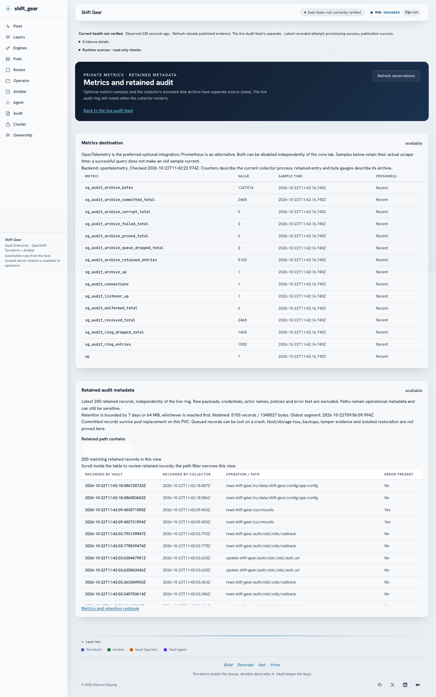
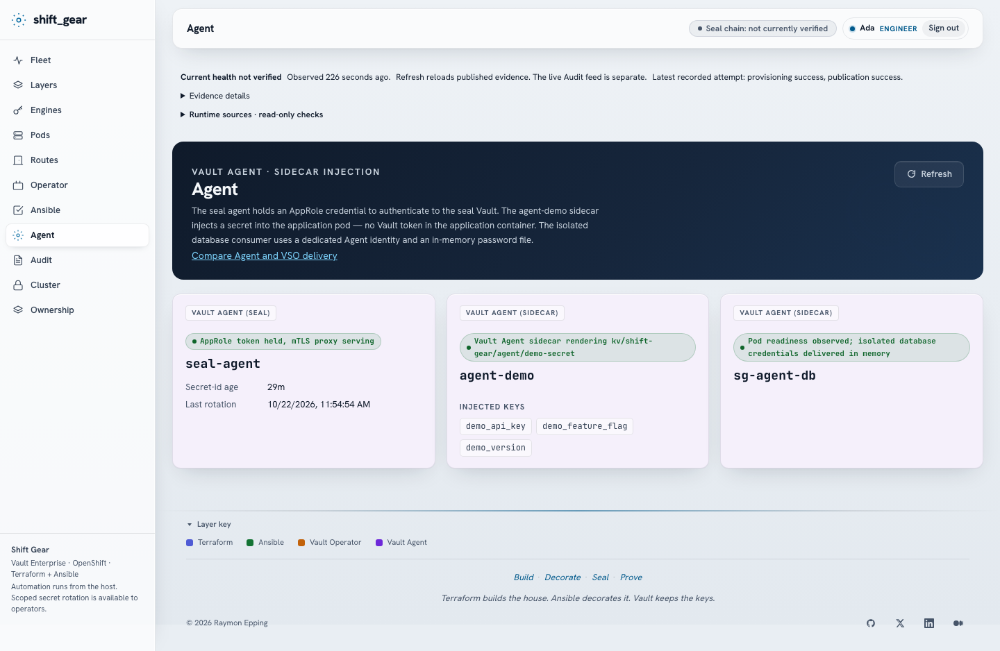

# Keep the Dream Alive

*Vault Enterprise on OpenShift: the fifth article, and the lab where I finally tested the substrate contract.*

---

> *I'm no stranger to this place*
> *Where real life and dreams collide*
> — Oasis, *Keep the Dream Alive* (2005)

Article four ended with the words *"This is the last one."* I meant it when I wrote them.

That article closed the Multipass arc. Three labs, three builds of the same Vault platform, and finally the boundary between Terraform and Ansible enforced by Vault policy. There was nothing left to prove on Multipass.

There was something left to prove about the architecture itself. Since article one I had claimed that the Vault platform does not know what it runs on. Every lab ran on Multipass VMs, so the claim had never met a real change of substrate. I had an output contract and three implementations on the same kind of infrastructure. I still needed to move the platform somewhere that would force different decisions.

I had been on OpenShift before. `red_doors` ran Vault Enterprise on OpenShift Local, built by hand for that substrate. This lab is different: the same contract-driven architecture as `golden_ticket`, moved from VMs to a cluster, with a grep that is allowed to fail the build.

I called it Shift Gear. The move changed how I provisioned, reached, restarted and observed almost everything. The four Vault servers remained: a dedicated seal Vault and three Raft members. The tool boundary remained too. Getting those two things to survive the move was the work; the clean rebuild would be the proof. Later reviews kept changing what I needed to check: runtime access, declared ownership, retained metadata and a second secret-delivery pattern. I kept the rebuild measurements separate from those later results.

---

## What did not change

The ownership rule is the same. Terraform builds the house: anything with an API and a lifecycle, such as namespaces, Helm releases, Routes, NetworkPolicies, and Vault structure (mounts, policies, token roles, audit devices). Ansible decorates it: anything with an order and a moment, such as init, unseal, credentials, people, seeds and proofs. Vault policy enforces the line between the two tools' Vault credentials. Kubernetes objects need their own ownership decisions, down to individual fields when more than one actor touches them.

The seal chain is the same. A dedicated seal Vault holds a transit key. The three cluster Vault pods unseal themselves through it on every restart. Their seal stanza says `token = "agent-supplied"`, and a seal agent in front of the seal Vault logs in with AppRole, holds a short-lived token in memory, and proxies the transit calls over mTLS. The cluster Vault pods have no usable seal token; the agent replaces the placeholder with its own authenticated token on each proxied request.

```text
Cluster Vault pods
  → mTLS to the seal agent
  → agent injects its AppRole-authenticated token
  → HTTPS to the seal Vault's transit key
```

That removes the long-lived seal-token file from the cluster Vault pods. Credentials still exist. The agent mounts a role-id and secret-id from a Kubernetes Secret, and the rotator has a separate secret-id of its own. I have to protect, scope and rotate those credentials too. The agent's ID expires after 24 hours; the rotator's ID has no expiry. Both permit repeated logins. I keep that distinction explicit because "no seal token" can otherwise sound like "no credential to look after."

The agent's own credential rotates. A `seal-rotator` CronJob runs every six hours: one step mints a new secret-id with the Vault CLI, the next patches the Kubernetes Secret, restarts the agent and destroys the old ID. `make rotation-proof` runs that job twice and then asks the seal Vault three questions through lookup and list operations: is the previous ID gone, does the current one exist, and is there exactly one. I cannot prove old-ID invalidation by logging in from my Mac, because the AppRole only accepts logins from the cluster's pod network. A controller-side login would test the CIDR restriction before it tested the ID.

The phase list interleaves Terraform and Ansible because neither tool can build the stack alone. Terraform cannot init a Vault cluster. Ansible should not own a namespace. Thirteen phases, in order:

```text
tf      infra
tf      foundation
ansible prepare
tf      workloads
ansible seal-init
tf      seal
ansible agent
ansible bootstrap
tf      platform
ansible identity
ansible configure
ansible ux
ansible validate
```

Three gates follow: idempotency (every Ansible phase again, `changed=0`, with one named evidence-publication task allowed to change), drift (every Terraform plan empty), and a secret scan of required sources and delivery artifacts.

`make boundary` is a separate proof of the four tokens' permissions. Standalone `make drift` also runs the Ansible playbooks in check mode. I keep those commands separate in the account of a run: the three automatic lab gates do not claim to execute every test in the repository.

What changed is the implementation. A `systemd` unit became a Helm release. `firewalld` became a `NetworkPolicy`. A `systemd` timer became a `CronJob`. Ansible stopped SSH-ing to nodes; it talks to the Vault API through a Route, and to the cluster through the Kubernetes API.

---

## The substrate contract

Shift Gear makes the series' central idea operational with one Terraform root, `terraform/infra/`. It reads the running cluster and emits a six-field output:

```hcl
output "cluster" {
  value = {
    api_url         = var.api_url
    apps_domain     = local.apps_domain
    pod_cidr        = local.pod_cidr
    kubeconfig_path = var.kubeconfig_path
    ingress_ca_path = local.ingress_ca_path
    registry_host   = "image-registry.openshift-image-registry.svc:5000"
  }
}
```

Two fields are discovered. `apps_domain` comes from `ingresses.config.openshift.io/cluster` and `pod_cidr` from `networks.config.openshift.io/cluster`. A third is fetched: the router's CA comes from the `default-ingress-cert` ConfigMap in `openshift-config-managed`, using its `ca-bundle.crt` key, and is written to the file `ingress_ca_path` names. These are OpenShift API objects rather than CRC command output. The current implementation also assumes the internal image registry is enabled and reachable at the service address in the contract.

Every Route hostname in the stack is `<name>.${apps_domain}`. The CIDR-bound AppRoles consume `${pod_cidr}`. Kubernetes and Helm providers consume `${kubeconfig_path}`; Vault providers derive their addresses from `${apps_domain}`. No root above `terraform/infra/` has a substrate-specific domain, a pod CIDR or a kubeconfig path of its own.

`make check` enforces it:

```sh
grep -rnE 'crc|vfkit|api\.crc\.testing|apps-crc\.testing' \
  terraform/foundation terraform/workloads terraform/seal terraform/platform \
  ansible deploy policies \
  --include='*.tf' --include='*.yml' --include='*.yaml' --include='*.hcl' \
  --include='*.j2' --include='*.sh' --include='*.json'
```

The real check also covers the operational scripts, with exclusions for the CRC lifecycle helpers and for the check's own patterns. Calling a lifecycle helper by name is allowed; hard-coding cluster knowledge in a platform script is not. One violation fails the build. During the build, a console trust script added late had `shiftgear.apps-crc.testing` written into it. The fix was the same as everywhere else, read `apps_domain` from the contract.

`golden_ticket`'s `lab_nodes` output was the same idea for VMs: a map of node names to addresses that the rest of the automation consumed without knowing they were Multipass. Shift Gear moves the idea to a cluster API.

The grep checks for named substrate references in the automation it scans. It cannot find an assumption that uses different words, or prove that `make lab` succeeds on ROSA or an OpenShift cluster hosted on vSphere. That needs another run. The contract says what that next cluster must supply; the registry, storage, ingress and trust assumptions still have to hold there.

---

## What OpenShift changed

**No nodes to reach.** In `golden_ticket`, Ansible SSH-ed to the addresses in `lab_nodes`. Here there is nothing to SSH to. Ansible talks to `https://vault.${apps_domain}` for Vault, and uses `kubernetes.core.k8s_exec` when something has to run inside a pod: initialising Vault, joining followers to Raft, seeding the LDAP directory. The roles were written for this; they do not open a single shell connection.

**The Vault Secrets Operator.** In the VM labs, application secrets had no clean way to reach a workload. VSO is that way on OpenShift. Custom resources declare what to sync, the operator syncs it, and a Kubernetes Secret appears in the namespace. The workload reads a file and has no Vault address in its environment.

**In-cluster builds.** The console is a Nuxt 4 application with a small server side that talks to Vault on behalf of the signed-in user. Building it on the Mac and pushing it to the cluster registry was the obvious route; I did not take it. Terraform declares a `BuildConfig` and an `ImageStream`. Ansible uploads the source with `oc start-build --from-dir` and the image is built inside the cluster. The console also needs evidence that only exists on my Mac: `evidence.json`, `layers.json`, `validation.json` and `convergence.json`. Ansible secret-scans those four files, then publishes them as the `sg-evidence` ConfigMap, which the console mounts read-only.

Each change was real work. I rewrote the substrate implementation while keeping the ownership rule, the seal chain and the output contract as constraints on that work. The contract did not make a VM role into a Kubernetes role by itself; it gave me a boundary to check while I made the move.

---

## The Vault Secrets Operator is the third layer

`golden_ticket` separates Terraform provisioning from Ansible configuration. Shift Gear adds the Vault Secrets Operator, VSO, to keep application secrets current after those tools have finished. Terraform declares the operator's custom resources. Ansible prepares the auth configuration and seed data. VSO reconciles the Vault source with the destination Kubernetes Secret at runtime.

The `VaultStaticSecret` declaration in `terraform/workloads/main.tf`, with metadata labels omitted here:

```hcl
resource "kubernetes_manifest" "vso_static_app_config" {
  manifest = {
    apiVersion = "secrets.hashicorp.com/v1beta1"
    kind       = "VaultStaticSecret"
    metadata   = { name = "app-config", namespace = "sg-workloads" }
    spec = {
      vaultAuthRef = "default"
      type         = "kv-v2"
      mount        = "kv"
      namespace    = "shift-gear"
      path         = "shift-gear/config/app-config"
      refreshAfter = "30s"
      destination  = { create = true, name = "app-config" }
      rolloutRestartTargets = [
        { kind = "Deployment", name = "workload-a" }
      ]
    }
  }
}
```

The operator authenticates to Vault with the projected service account token of `vso-workloads`, through Kubernetes auth. It reads the secret in the `shift-gear` namespace every 30 seconds and writes the `app-config` Secret in `sg-workloads`, which workload-a mounts read-only.

`make wl-a-rotate` writes a new version of the KV secret. VSO’s 30-second refresh interval drives the Secret update and, because of `rolloutRestartTargets`, restarts workload-a so it reads the new value. Workload-b gets the same treatment from a `VaultDynamicSecret`: database credentials from `database/creds/demo-reader`, renewed at 67% of their lease.

VSO authenticates with a service account token and manages its own Vault session. The application container reads the resulting Secret without a Vault token.

The destination still contains credentials when the application needs credentials. Workload-b receives a PostgreSQL username and password. Removing the application's Vault token reduces what it can do against Vault; it does not make the database credential disappear or remove Kubernetes RBAC from the security model. The Secret is another copy of the delivered data, and I have to control who can read it.

I tested the two directions separately. Scenario 06 changes the source in Vault and checks that VSO syncs it and rolls workload-a; that run completed in 21 seconds. Scenario 09 edits the destination Secret by hand and checks that VSO restores the Vault value; that took six seconds. One proves delivery of an intended change, the other proves which system wins when the delivered copy is altered.

For dynamic credentials I revoked the exact `database/creds/demo-reader` lease. Scenario 07 waited for a new username in `db-creds`, checked that the old PostgreSQL role had disappeared, and confirmed workload-b recovered. It took 148 seconds. The Ansible token used for that proof can revoke an individual lease under the demo-reader path. The generic and prefix revoke paths remain denied, as does a different database role. I did not widen the bootstrap token to make a resilience test easier.

---

## The token boundary on OpenShift

`golden_ticket` introduced four bootstrap tokens, each scoped by Vault policy to what its tool needs. Shift Gear keeps all four.

`sg-tf-seal` may create the transit mount, the key and the AppRole role on the seal Vault. It may not mint a secret-id. `sg-ansible-seal` may mint secret-ids and read role-ids. It may not create a mount. `sg-tf-platform` may create mounts and write policies. An explicit deny stops it from enabling auth methods or reading KV data. `sg-ansible-platform` may enable auth methods and write KV data. It may not create a mount or write a policy.

`make boundary` asks Vault, through `sys/capabilities-self`, what each token may do on the paths that matter, and compares the answer with the expectation. The checked paths and results:

**`tf-seal` against `vault-seal`**

- `sys/mounts/transit`: `allow:create`; PASS.
- `transit/keys/autounseal`: `allow:create`; PASS.
- `auth/approle/role/sg-seal-autounseal`: `allow:create`; PASS.
- `auth/approle/role/sg-seal-autounseal/secret-id`: `deny:update`; PASS.
- `sys/policies/acl/sg-tf-seal`: `deny:update`; PASS.

**`ansible-seal` against `vault-seal`**

- `auth/approle/role/sg-seal-autounseal/secret-id`: `allow:update`; PASS.
- `auth/approle/role/sg-seal-autounseal/role-id`: `allow:read`; PASS.
- `sys/mounts/transit`: `deny:create`; PASS.
- `sys/policies/acl/autounseal`: `deny:update`; PASS.

**`tf-platform` against `vault`**

- `shift-gear/sys/mounts/transit`: `allow:create`; PASS.
- `shift-gear/sys/policies/acl/sg-engineer`: `allow:update`; PASS.
- `shift-gear/sys/auth/kubernetes`: `deny:create`; PASS.
- `shift-gear/kv/data/shift-gear/config/app-config`: `deny:read`; PASS.
- `shift-gear/sys/mounts/kv`: `deny:delete`; PASS.

**`ansible-platform` against `vault`**

- `shift-gear/sys/auth/kubernetes`: `allow:create`; PASS.
- `shift-gear/kv/data/shift-gear/config/app-config`: `allow:create`; PASS.
- `shift-gear/sys/mounts/transit`: `deny:create`; PASS.
- `shift-gear/sys/policies/acl/sg-engineer`: `deny:update`; PASS.
- `shift-gear/sys/policies/acl/sg-ansible-platform`: `deny:update`; PASS.

All 19 checks passed.

The check fails closed. A missing token, an unreachable Vault or an empty answer is a failure, never a pass, and the run must count exactly 19 rows. Vault enforces the permissions on the token making the request. A Terraform invocation using its platform token cannot enable an auth method because somebody is in a hurry.

There is still a bootstrap authority. The initialisation files retain root tokens locally with mode 0600. The seal-init and bootstrap phases use them to reconcile the bootstrap policies and token roles, then issue or renew the four scoped tokens. Those are periodic orphan tokens with a 24-hour period. Terraform and the later configuration phases use their scoped credentials. Root access remains capable of changing the boundary, so custody of the retained initialisation material is part of the design.

I also keep secret values out of Terraform's ownership surface. Terraform names Kubernetes Secrets that Ansible creates; it does not populate them with passwords, licence text or private keys. Vault structure goes into state, while KV data, database passwords and AppRole secret-ids are written by Ansible with secret-bearing output suppressed. The secret scanner checks the resulting state, logs and evidence for known values and token, key and licence patterns. A clean scan is evidence about the files it examined, alongside the ownership decision that kept the values out of the state in the first place.

---

## The receipt

Four labs, with the same details recorded for each:

**`multi_pass`**

- **Substrate:** Multipass VMs.
- **Terraform roots:** 3.
- **Phases in `make lab`:** n/a.
- **Vault servers:** 3.
- **Usable seal token in cluster Vault nodes or pods:** n/a (Shamir).
- **Application secret delivery:** n/a.
- **Swapping the substrate:** rewrite infra roles.

**`red_pass`**

- **Substrate:** Multipass VMs.
- **Terraform roots:** 0.
- **Phases in `make lab`:** 9.
- **Vault servers:** 4 (3 + seal).
- **Usable seal token in cluster Vault nodes or pods:** none (seal agent holds it).
- **Application secret delivery:** n/a.
- **Swapping the substrate:** rewrite three Multipass roles.

**`golden_ticket`**

- **Substrate:** Multipass VMs.
- **Terraform roots:** 3.
- **Phases in `make lab`:** 11 + 3 gates.
- **Vault servers:** 4 (3 + seal).
- **Usable seal token in cluster Vault nodes or pods:** none (seal agent holds it).
- **Application secret delivery:** n/a.
- **Swapping the substrate:** new `terraform/infra` (contract written, never tried).

**`shift_gear`**

- **Substrate:** OpenShift (CRC).
- **Terraform roots:** 5.
- **Phases in `make lab`:** 13 + 3 gates.
- **Vault servers:** 4 (3 + seal).
- **Usable seal token in cluster Vault nodes or pods:** none (seal agent holds it).
- **Application secret delivery:** VSO for the two existing workloads; an additional isolated Agent-to-file database consumer; no Vault token in the application containers.
- **Swapping the substrate:** new `terraform/infra` (contract enforced by grep, one implementation).

`golden_ticket` wrote the contract down and admitted it had never been tested. Shift Gear moved the platform from Multipass VMs to an OpenShift cluster and kept the contract-driven design. The Kubernetes implementation required new provisioning and configuration code; I can now show which assumptions stayed behind the substrate boundary. A second OpenShift deployment is still needed to test the narrower claim that another cluster can satisfy this six-field contract without changes above `terraform/infra/`.

---

## Drift, both kinds, and a third

Terraform drift: someone edits a Terraform-owned Deployment with `oc edit`, or disables a Vault mount by hand. `make drift` runs `terraform plan -detailed-exitcode` on all five roots. Exit code 2 means drift, the plan shows what changed, and `make lab` puts it back.

Ansible drift: someone changes a Keycloak client in the admin console. `make drift` runs every playbook with `--check`. Any unexpected `changed` task is drift. The one documented exception is the named evidence-publication task in ux, because the evidence carries a timestamp. A different task changing in that same phase still fails the gate.

LDAP membership needs a separate check: federation tasks skip check mode.
Scenario 08 compares the policies from a fresh login before and after adding
a group, then restores the original membership.

Terraform only sees what it declared. A stray ConfigMap or a hand-made Service is invisible to it. That is correct, and a reason to keep the Terraform surface small.

The third kind came from a legitimate runtime action. After a secret rotation, the drift gate failed on `workload_b`:

```text
# kubernetes_deployment.workload_b will be updated in-place
  ~ annotations = {
      - "vso.secrets.hashicorp.com/restartedAt" = "2026-10-09T09:01:33Z" -> null
```

`rolloutRestartTargets` restarts a workload by stamping that annotation on the Deployment's pod template, and the Deployment belongs to Terraform. Two owners were writing to one object. The fix was to give Terraform an `ignore_changes` for that single annotation, with a comment saying whose it is, and nothing else. The lesson carries beyond VSO: when an operator acts on an object your IaC owns, decide in code which fields belong to whom.

The fresh rebuild later caught the same ownership mistake on the seal agent. Ansible stamps `shift-gear/credentials-rotated` on its pod template after replacing the AppRole credential, so Kubernetes starts a new pod with the new ID. Terraform wanted to erase that stamp. Ansible's idempotency gate was green, yet the workloads plan still had one change.

I gave Ansible ownership of that one annotation:

```hcl
lifecycle {
  ignore_changes = [
    spec[0].template[0].metadata[0].annotations["shift-gear/credentials-rotated"],
  ]
}
```

Images, labels, resources and the rest of the Deployment remain in Terraform's comparison. Ignoring the entire pod template would also hide changes I want the drift gate to catch. After the correction, the read-only workloads plan was empty. I then reset the lab and VM again to test the correction from nothing.

From `docs/operations.md`:

- **Terraform:** `oc edit deployment workload-a` (add a label). Detected by: `make drift` (plan shows the diff).

- **Ansible:** `sg-cli` client name changed. Detected by: Identity check mode reports the change and a real identity run restores it.

- **LDAP:** Ben added to `engineers`. Detected by: A fresh LDAP login gains `sg-engineer`; removing the membership removes it again.

- **VSO:** `app-config` Secret edited by hand. Detected by: Scenario 09 saw VSO restore the Vault value after 6 seconds.

---

## The console learned the substrate

The `golden_ticket` console had a Front door page for the Nginx routes, a Layers page for the phases, and a Cluster page with VM-level data. The Shift Gear console keeps that shape and adapts it to OpenShift. I began with three data paths: host-published evidence, Vault calls made with the visitor's own token, and a live read from the socket-audit collector. I later added bounded runtime probes and optional metrics and retained-metadata reads. The source of a number determines how I have to test it.

The **Layers** page shows the interleaved phases with their last apply, last plan or last run, measured durations, and the gates with their results.

The **Routes** page lists every OpenShift Route with its TLS termination: `passthrough` for both Vaults, `reencrypt` for Keycloak and `edge` for the console.

I also had to fix where a person enters that system. Opening Keycloak's root URL originally led to the master-realm admin-console login. Sending the visitor to the account console of the application realm only changed which Keycloak client requested a login; it still did not show the Shift Gear sign-in page. I wanted the application entrance at `/signin`, with the administrative and protocol endpoints still reachable at their own paths.

I kept that behavior in HAProxy, as in `red_pass` and `golden_ticket`. An OpenShift Route annotation could not express the exact-path rule I needed. A small HAProxy sidecar in the Keycloak pod now redirects only `/`:

```text
http-request redirect location https://shiftgear.${local.apps_domain}/signin code 302 if { path / }
```

The hostname comes from the substrate contract. Requests to `/admin` and `/realms` pass through to Keycloak. The router re-encrypts to the proxy, and the proxy verifies Keycloak's certificate with the project CA before forwarding to port 8443. `make verify` checks the root response and its destination: HTTP 302 to the application's `/signin` page. Correcting the front door did not require changing the identity of the admin console.

The **Operator** page shows each `VaultStaticSecret` and `VaultDynamicSecret` with its last observed sync time and status. I run `make ux` after a rotation to refresh that snapshot.

The **Engines** page lists what is mounted, and also what is deliberately not mounted. The licence includes Key Management, KMIP and Transform. Terraform's `skipped_engines` output names each one with its reason: Key Management needs a cloud KMS this lab doesn't have, KMIP needs a TLS client-access path that this lab has not provisioned, and tokenisation is a different story from encryption as a service. The recorded KMIP reason refers to raw TLS on port 5696 and the router's HTTP/SNI paths; I have not tested a KMIP exposure design here. A visitor sees the decision and the reason instead of wondering what is missing.

Engines attempts a live `sys/mounts` read with the signed-in person's Vault token. If that person's policy denies the request, it can return the evidence snapshot while marking the state as denied. An unreachable Vault is another state. The snapshot lets the console show the declared platform without granting each visitor an operator's token to make the page work.

The Playwright suite covers the console in desktop and mobile projects, including axe accessibility scans at 1440 and 390 pixels wide and with reduced motion. After the clean rebuild, all 104 standard tests passed with browser TLS verification enabled. I had found `ignoreHTTPSErrors: true` in the earlier browser setup. Removing it made certificate trust part of the tested journey. A page that renders after the browser ignores its certificate cannot prove that journey.

The persona-switch test signs Ada in, signs her out, checks that `/api/session` returns 401, then signs Ben in. Keycloak's SSO session is terminated through the server-side backchannel logout path, so Ben does not inherit Ada's login. The browser verifies the change of identity as well as the return to `/signin`. Role-dependent controls are tested with different people too: Cleo can see operator actions that Ben cannot.

The failover browser test needed a different correction. The Cluster page reads the mounted evidence snapshot. Deleting a Vault leader and reloading that page repeatedly would keep reading the old snapshot until I published new evidence. That test could wait forever while Raft had already recovered.

The corrected journey publishes evidence before choosing the leader, confirms the browser sees it, deletes that pod and waits for actual deletion. It then finds a different live leader, waits for the replacement pod to be Ready, republishes evidence and checks the browser's new leader and 3/3 unsealed view. That separate, serialized test passed in 2.3 minutes. It proves failover and the evidence-to-browser path together. It does not claim the Cluster page is a live telemetry feed.

I also captured and inspected all 22 desktop and mobile screenshots. The browser assertions, accessibility scans and visual inspection answer different questions. A test can find the correct text while the page still clips it at 390 pixels.

---

The **Audit** page reads the socket collector live. I keep up to 1,000 entries in memory, showing request metadata and the names of HMAC-protected fields without retaining those secret values; the counters reset when the collector restarts.

Terraform's platform root owns the two Vault audit devices. One writes to stdout for OpenShift log collection; the other sends JSON lines to `sg-audit.sg-app.svc:9090`. The workloads root owns the collector's ConfigMap, Deployment, Service and NetworkPolicy. The collector accepts ingest from the Vault pods and exposes its HTTP read API on port 8080 to the console server. It needs neither a Vault token nor a Kubernetes token.

Every signed-in console user may read this view. Display names, policies, paths and operations remain visible, so HMAC protection of secret fields does not make the stream anonymous. I discard those secret values in the collector's projection and keep the metadata the page needs. This live view is a bounded, volatile inspection buffer. I later added a separate storage and retention path for a narrower metadata archive, described below. Enabling that archive does not change the live ring's restart behavior.

The independent stdout device also keeps Vault from depending on that small collector's availability. In the collector restart proof, Vault continued to answer HTTP 200 and reconnected on the next audited request. If every enabled audit device fails, Vault cannot use that fallback. `make validate` checks delivery by making an audited request and observing the collector's received counter increase.

---

## What I had to break before I could call it green

The review began with a failed baseline. Ansible repeatedly tried to set an empty logout-redirect attribute on `sg-cli`; Keycloak removed the empty value, so the next run tried again. Identity reported `changed=1` every time. Login worked, but the configuration had never converged.

The fix was to omit the logout-redirect parameter for clients without a configured list, using `default(omit)`. The Vault client's real logout redirects stayed configured. I kept the change visible to Ansible and proved the repeat run, rather than declaring that task unchanged with `changed_when: false`.

Then I ran the nine scenarios against a converged lab, one at a time. The cold start came last because it stopped and restarted the most state. These are the recorded results from that verification sequence:

- **01 — Active Vault pod deletion:** A different leader was elected; the replacement pod rejoined unsealed. Result: PASS; time: 10 s.

- **02 — Seal-agent restart:** A new pod UID and successful authentication; cluster health remained available. Result: PASS; time: 1 s.

- **03 — AppRole rotation:** Previous ID absent, current lookup HTTP 200, exactly one ID. Result: PASS; time: 10 s.

- **04 — Seal-Vault restart:** Health was re-read after manual unseal and the seal Vault recovered. Result: PASS; time: 36 s.

- **05 — Full cold start:** Workloads down, VM restart, readiness-gated up, stack verification. Result: PASS; time: 303 s.

- **06 — Static secret rotation:** New Vault value, VSO sync, workload-a rollout. Result: PASS; time: 21 s.

- **07 — Dynamic credential revoke:** New database username, old role removed, scoped revoke enforced. Result: PASS; time: 148 s.

- **08 — Drift detection:** Terraform, Keycloak, workload and LDAP mutations detected and restored. Result: PASS; time: 97 s.

- **09 — Hand-edited Secret:** VSO restored the Vault source value. Result: PASS; time: 6 s.

These times belong to those runs. They are neither a service-level objective nor a promise that every restart will finish that quickly. Scenario 02's one-second result, for example, records that particular pod replacement and authentication check; it does not measure recovery from losing the whole Mac.

Scenario 08 needed to prove that the mutations happened before accepting their detection. A permission denial cannot count as successfully creating drift. A clean Terraform plan cannot count as detecting the deliberately changed resource. For LDAP, I compared policies from fresh logins before and after adding Ben to `engineers`, then removed the membership and checked again. The script restores the mutations before it declares success.

I tightened the rotation proof too. An old-ID lookup returning an unexpected 403 or 500 could mean the test lost permission or Vault failed; it would not prove the old ID was absent. The proof now accepts only the intended absence responses, checks the current ID separately, and lists the remaining IDs.

Finally, I checked the application's secret boundary inside the Agent demo. The init container and sidecar render `/vault/secrets/demo-secret` for the application. Their token sink used to share that directory. I moved it to `/vault/token/.token` on a separate memory-backed volume mounted only by the Agent containers. The app keeps the rendered data and has no token file at either location in its own mounts. That file-content check complements the pod-environment scan; checking only for a `VAULT_TOKEN` environment variable would have missed the shared file.

---

## From nothing to converged

`golden_ticket` went from nothing to fully converged in 17 minutes 12 seconds on the same Mac.

In the successful clean rebuild, `make crc-reset && make lab` took 13 minutes 17 seconds: 3m18s to create the CRC VM and 9m59s wall time for the lab, including its final evidence republish. The recorded 9m00s lab run spent most of its time in the idempotency gate (2m50s), ux (2m11s), and identity (1m13s). That put Shift Gear 3 minutes 55 seconds ahead of `golden_ticket` on the same Mac.

I measured it on a 12-core Apple M4 Pro MacBook Pro with 48 GB RAM. CRC ran OpenShift 4.22.14 with 8 vCPU, 24,576 MB RAM and an 80 GB disk. The CRC bundle cache was preserved, as were the pull secret, local configuration and lab CA. The generated state and namespaces were reset, and the VM was recreated. "From nothing" here means a new VM and new lab state with those local prerequisites retained; the time does not include downloading the OpenShift bundle or installing the tools.

The first fresh-VM attempt failed. All Ansible phases passed idempotency, but gate 15 found the seal-agent annotation drift described above. I kept the failed log and plan, corrected the field ownership, then destroyed and recreated the lab again. The successful attempt required no manual repair between bootstrap and the gates. Continuing the failed run after applying a fix would have measured a repaired cluster.

The recorded phase and gate timings, alongside the independent second run:

- **infra (Terraform):** Fresh lab 0m03s; converged re-run 0m03s.

- **foundation (Terraform):** Fresh lab 0m05s; converged re-run 0m03s.

- **prepare (Ansible):** Fresh lab 0m16s; converged re-run 0m05s.

- **workloads (Terraform):** Fresh lab 0m20s; converged re-run 0m03s.

- **seal-init (Ansible):** Fresh lab 0m19s; converged re-run 0m06s.

- **seal (Terraform):** Fresh lab 0m01s; converged re-run 0m01s.

- **agent (Ansible):** Fresh lab 0m13s; converged re-run 0m11s.

- **bootstrap (Ansible):** Fresh lab 0m36s; converged re-run 0m10s.

- **platform (Terraform):** Fresh lab 0m03s; converged re-run 0m01s.

- **identity (Ansible):** Fresh lab 1m13s; converged re-run 0m31s.

- **configure (Ansible):** Fresh lab 0m29s; converged re-run 0m10s.

- **ux (Ansible):** Fresh lab 2m11s; converged re-run 0m59s.

- **validate (Ansible):** Fresh lab 0m11s; converged re-run 0m11s.

- **idempotency (Gate):** Fresh lab 2m50s; converged re-run 2m28s.

- **drift (Gate):** Fresh lab 0m07s; converged re-run 0m06s.

- **secret-scan (Gate):** Fresh lab 0m02s; converged re-run 0m03s.

- **Recorded total (`make lab`):** Fresh lab 9m00s; converged re-run 5m11s.

On that converged re-run every Terraform plan was empty and every enforced Ansible phase reported `changed=0`, except the documented evidence republish in ux. `make lab-times` reads the latest convergence record; I saved the first run separately before the second could overwrite it. The recorded total ends before the final evidence sync, which accounts for the difference between the first lab's nine-minute record and its 9m59s command wall time. The difference from `golden_ticket` is arithmetic for these two builds, not a controlled benchmark of OpenShift against Multipass.

The clean-rebuild proof set was 18/18 static checks, 22/22 stack checks, 19/19 token-boundary checks and 104/104 standard Playwright tests with TLS verification enabled. UI type-check and lint passed. Both labs had five empty Terraform plans and clean secret scans. The failover journey and all 22 screenshots had passed separately. The full second lab took 5m11s in the convergence record; it proves a stable repeat run, while the saved first record proves bootstrap. I kept the measured timings in `docs/operations.md` and the run-by-run results, including the failed attempt, in the roadmap proof log.

---

## The second review had to survive its own tests

After the rebuild, I reviewed the platform again around the way I would operate it. I wrote a PRD and a MoSCoW roadmap covering the console, Vault, Terraform and Ansible. The Must work made the existing actions, observations and proofs stricter. That exposed failures the earlier rebuild had never exercised in the same sequence.

A healthy snapshot needs a time and a source. I added schema validation, observation age and cluster/run identity, and kept retrieval time separate from observation time. Reloading a page cannot make an old observation new. A published status snapshot becomes stale after 120 seconds; the console says so even when the recorded health was good. Missing, malformed and future-dated evidence cannot turn into a green tile. I kept that snapshot model instead of granting the console broad administrative access to make every page look live.

The Operator page needed the same honesty about writes. I disabled the unsupported Agent re-injection control. KV rotation preserves unrelated fields and uses compare-and-set against the version it read. Each operation has a receipt, and a retry can reuse the result. A request that may have written but has no confirmed delivery remains accepted and unverified. The console cannot infer that an application consumed a secret because Vault accepted a new version. I tested allowed and denied requests directly for all five personas, including unchanged KV metadata after a forbidden write and version ordering under concurrent rotations.

Logout needed two independent sessions to prove the provider callback did anything. I made the BFF verify the callback's signature, issuer, audience, time, event and replay identity, then invalidate sessions for the matching subject. Keycloak also needed the ingress CA to verify its outbound callback. Both sides keep certificate verification enabled. The test signs in twice, signs out through the real provider and checks that the second BFF session receives 401.

That test exposed a fault in the browser helper during the complete sequence. After provider logout, the saved session files were dead. The helper could sign in again, but did not replace those files, so later tests kept repeating the login. I saved the replacement state privately and reused it. The isolated journey and the full browser sequence then passed together. I kept the production login rate limit.

I also found a credential that contradicted the Terraform ownership rule. A long-lived Kubernetes token-reviewer JWT had reached current Terraform state through a managed Secret. I removed that value-bearing resource from current state and configured Vault to use its pod's rotating projected identity with `system:auth-delegator`. I proved a fresh Kubernetes-auth login before retiring the old Secret. Historical state backups can still contain the retired JWT; they remain private custody material. Removing a resource from current state does not erase its history.

For the seal Agent, I tested expiry separately from lookup success. The installed Vault build could retain an expired SecretID and answer its lookup. Repair now checks expiration metadata, replaces the credential and explicitly revokes the predecessor. The drill checks a fresh replacement login and rejects predecessor reuse. For TLS I renewed leaves under the same root, checked the certificates served by both Vault Routes and rolled the main cluster with actual unsealed-member checks. A new root would require another trust migration; I have not rehearsed that here.

The cold start found a different kind of shared state. `crc stop` inherited the project's `KUBECONFIG` and removed its connection entries. A nested automation command could no longer resolve the target it already owned. I isolated CRC control commands behind a private temporary kubeconfig and made the cold-start scenario compare the project's configuration bytes across shutdown. The lock now verifies inherited ownership and unchanged configuration; a configured target that cannot be resolved fails closed. I tested the wrapper with a stub that deliberately clears its kubeconfig, then ran the real VM stop/start under the owning workflow.

Another scenario had declared success when the replacement Vault pod rejoined, before the public Route had recovered. I added a bounded wait for all three unsealed members and the public HA/Raft postconditions. The verification immediately after it then passed. I kept the checks strict and changed what the scenario waited for.

At the end of that review, the complete local ladder passed all 36 steps on unchanged automation inputs:

- **Static checks:** 18/18.

- **Offline regressions:** 33/33: 22 Python, six UI utility and five collector tests.

- **UI type-check and lint:** PASS.

- **Standard desktop/mobile browsers:** 120/120, with TLS verification enabled.

- **Separate browser failover:** 1/1.

- **Screenshot journeys:** 2/2.

- **Scenarios:** All nine, each followed by full verification.

- **Stack verification / token boundaries:** 23/23 / 19/19.

- **Complete labs / full drift checks:** Three / three.

- **Credential expiry / same-root certificate renewal:** PASS / PASS.

The ladder took about 44 minutes, including the VM cold start. Its receipt records the input digest, cluster and run identities, every step's exit code, and the fact that the checkout was uncommitted. I separately injected a publication failure, retried publication for the same run and compared all five protected Terraform state files byte for byte. Publishing evidence did not rerun provisioning or alter those states.

I kept the failed attempts. The passing receipt identifies one complete run whose inputs stayed fixed; a collection of successful fragments would not establish that. The release workflow requires a clean revision and a matching receipt from the protected live workflow. I have proved the local ladder, while protected GitHub execution remains outstanding.

Data restoration remains unfinished too. I explicitly deferred the isolated recovery proof. The earlier clean rebuild proves reconstruction of declared structure, and the cold start proves recovery of this existing VM and its data. Neither proves that I can restore both Raft stores, the seal dependency and a canary written after bootstrap into an isolated environment. That needs protected snapshots, a separate target and its own measured result.

---

## A status page needs its own boundaries

I followed that review with four more pieces of work: runtime observation, deeper PKI and Transit proofs, controlled dependencies and an investigation path through the console. I kept the existing design and ownership model. I wanted the page to help me decide what to inspect next, with enough evidence to explain that decision.

The console now has a separate Runtime sources disclosure. It checks the active Vault service and Keycloak discovery, then reads two named VSO resources and two named consumer Deployments. Those reads have a three-second deadline, a response-size limit, verified TLS and a short shared cache. A timeout, a trust failure, an access denial and a malformed response have different reason labels. Hidden tabs pause their polling. I kept the source time alongside the result so an old successful read can age out visibly.

For the Kubernetes reads I gave the BFF a projected service-account identity with GET access to those four resources. It cannot list resources, read Secrets, mutate a Deployment or execute a pod. I checked ten actual allowed and denied operations against the API. Vault health and identity discovery need no Vault token. The pages that use published evidence still say snapshot, and the active-service probe does not claim to have checked all three Raft members.

That also keeps rotation language precise. A ready Deployment and a newer VSO timestamp can help me investigate, but they do not identify which Vault version reached the application. The write receipt stays accepted and unverified until I have a correlated delivery observation. I did not turn those convenient status fields into proof they cannot provide.

I added an investigation guide linked from each source's owner and resource. Audit filtering now covers type and path inside the recent buffer, with bounded pages and a restart marker when the collector instance changes. The data pages share loading, failed-request and retry feedback. When a refresh fails, they identify retained data as previous observations. The expiry notice reacts when the session arrives, and the retry and paging journeys work from the keyboard. One test caught the refresh arrow being included in the button's accessible name; another caught the expiry notice waiting for its timer. I fixed both before accepting the new journeys.

For PKI and Transit I created dedicated fixtures. I can rotate the proof key, rewrap its ciphertext and check that the original ciphertext still decrypts without changing `app-data`. The certificate proof issues a client certificate, verifies its chain, rejects an unauthorized name and role, revokes through proof of private-key possession and checks the CRL. A separate five-second certificate must expire. The targeted run passed all 18 checks. Private keys and plaintext stay in memory; the console receives a dated result, a check count and the source digest.

Vault rejected my first attempt to issue that proof identity directly into the child namespace. I moved the issuance role into the root namespace and scoped its policy to the named fixture paths under `shift-gear`, plus self-revocation. The role caps the token at five minutes. Its namespace does not grant the root policy. I could keep the existing privilege boundary and still exercise the APIs I had declared.

Dependencies needed recorded identities too. I kept the five provider lockfiles, made routine initialization readonly and pinned the build bases and deployed images. Ansible records the console and LDAP build digests as explicit Terraform inputs; an unauthorized image edit still produces drift. The CLI image comes from a separate dependency output beside the unchanged six-field connection contract. OLM now waits for manual approval of the exact reviewed CSV and its current InstallPlan. The inventory checks active pods and current controller templates, while preserving the older references in finished Jobs as history.

At that stage I rehearsed one upgrade on the audit collector, before it had a persistent archive. Before the controlled run I downloaded and structurally inspected both Raft snapshots using short-lived, download-only maintenance identities. The files and their hashes stay under private custody. I then reconciled Node 22, upgraded to the selected Node 24 digest, checked audit delivery, rolled the configuration back to Node 22 and checked delivery again, then returned to Node 24. Each replacement had a new collector instance. That rehearsal passed; the volatile buffer reset as the design says it will.

I still need the separate isolated restore. These snapshots give me inspected local recovery material, and that collector rehearsal proves configuration rollback for the component as it existed then. Restoring Vault, identity or database data after an incompatible change needs its own target, canary and measured result. I kept that work deferred rather than letting a successful image rollback stand in for it.

The first full run of this increment stopped at 129 of 130 browser tests. At 195 CSS pixels, the audit grid expanded beyond the document. Once I constrained its tracks, the same journey reached the engines page and exposed a fixed 260-pixel card minimum there too. I capped the minimum at the available width and made the plugin metadata wrap. I also corrected the engine badges so snapshot data says Snapshot. The focused desktop and mobile rerun then passed all 16 cases.

For the next acceptance run I froze the executable inputs again and ran the expanded 41-step ladder from the beginning. All 41 steps passed, including 130 standard browser tests, the separate live failover, all nine scenarios with their postchecks, and the final idempotent lab and drift checks after cold start. I reviewed the desktop and mobile captures as well. The final inventory found no mutable image references in active pods or current workload templates. Four older tagged references remained recorded in completed Job pods.

That receipt still describes a local, uncommitted checkout. The host ran Node 25.2.1, outside the UI package's supported engine range; the build and deployed runtime use pinned Node 24. I recorded that limitation alongside the source digest rather than extending the support claim from one passing run. Protected CI on its declared runtime and the isolated restore still need their own results.

---

## Ownership needed a page of its own

As the lab grew, deciding who owned a field meant following the evidence, the Terraform declaration, the Ansible task and sometimes an operator's runtime annotation. I had already been caught by two legitimate writers changing the same Deployment. I wanted that ownership visible from the console as well as explained in comments.

I added the Ownership page at `/explorer`. It reads the published declarations in `policies/ownership-map.json` and the existing 19-operation expected-capability matrix. Each ownership entry names the declared owner, the runtime writer, any precise exception, the check and its runbook. The later telemetry and database-consumer work brought the registry from ten entries to twelve.

A row for workload delivery can therefore say that Terraform owns the declaration while VSO writes the delivered Secret and its restart annotation. The seal-agent entry can name Ansible's credential-rotation stamp without excusing the rest of the pod template from drift detection. Those are reviewable decisions about fields and actions. Listing a tool beside a resource would have hidden the disagreement I had already had to fix.

The page carries the source-file hashes, automation input digest and publication identity. I can filter declarations by owner and the expected capability rows by maintenance identity, path and allow or deny. Those filters operate on the published rows. They do not ask Vault to evaluate a path supplied by the browser.

I kept `make boundary` as the live check of the four maintenance tokens. A declaration saying `deny:read` describes the intended answer. The result of a request to Vault establishes the observed answer for that token and time. A source hash identifies the bytes that were published; it does not sign a review or make those bytes current authorization. The explorer added no Vault or Kubernetes permission, no policy editor and no token input.

The first API tests exposed a routing detail I could easily have missed by looking at the page. The existing Origin protection rejected an invalid POST before the endpoint's method handling ran. A POST with the correct Origin then fell through to Nuxt's HTML fallback and returned 200. There was no write capability, but the response still gave the wrong answer to a client trying to write. I made the endpoint reject that request explicitly with 405 and `Allow: GET, HEAD`, while keeping the separate Origin-denial check.

The first complete browser run found another mistake. An inline link on the investigation guide had no persistent underline. All sixteen failures were the same accessibility violation across the tested personas and layouts; 122 of 138 browser tests passed. I fixed the link cue and repeated the complete ladder. The corrected ownership-explorer run passed all 41 steps, with 138 standard browser tests. The passing functional explorer cases had not excused the broken link.

That page also gave the later additions somewhere to declare their owners. The metrics and retention row points to its own runbook. The Agent database consumer points to the delivery comparison and recovery procedure. I can follow a failed observation back to the declaration that should explain it.

---

## Telemetry had to remain optional

The next work was metrics and retained audit metadata. CRC had monitoring namespaces and a ServiceMonitor CRD, but no running Prometheus or logging service to receive this data. Finding an API type did not establish that a destination existed.

I chose OpenTelemetry as the preferred integration and kept Prometheus as an alternative. Both had to be optional. The core lab still had to provision, authenticate users and deliver secrets without either backend, and the live audit ring had to remain usable without an archive.

The repository defaults are explicit:

```hcl
metrics_backend               = "none"
audit_archive_enabled         = false
observability_storage_enabled = false
```

I can select `"opentelemetry"` or `"prometheus"` through a local `observability.auto.tfvars` file. That file contains no credentials, stays out of Git and participates in the automation input digest. The accepted working profile enabled OpenTelemetry and archive retention. A fresh checkout gets neither backend nor observability PVCs unless I opt in.

The accepted metrics view contains fifteen series: fourteen fixed numeric series from the audit collector, plus the scrape's `up` series. They describe received records, the ring, listener connections and the archive's queue drops, writes, failures, retained rows and bytes. The collector puts no person, request path, policy or payload into metric labels.

The preferred path uses an OpenTelemetry Collector with a Prometheus receiver and exporter:

```text
Audit collector :8081/metrics
  → OpenTelemetry receiver
  → memory limiter and batch processor
  → private Prometheus-format exporter :9090/metrics
  → authenticated console BFF
```

Prometheus is the wire format in that path. The OpenTelemetry mode deploys no Prometheus server and needs no time-series database. It scrapes every ten seconds, keeps bounded current samples and expires unrefreshed samples after sixty seconds. It has no service-account token or Kubernetes API role. I have not configured an external OTLP destination, historical metrics storage or trace collection in this lab.

The alternative mode runs a pinned Prometheus instance with a protected PVC. Its time-series blocks have seven-day and 128 MB retention limits. The WAL, head and compaction overhead sit outside that block-size limit, so I provisioned a 1 GiB claim and kept the storage explanation specific. A 128 MB retention setting does not impose an exact 128 MB disk cap.

The Services remain private. NetworkPolicies let the selected metrics reader scrape the audit collector's numeric listener and let the console read the selected adapter's output. They expose no public metrics Route. The internal HTTP transport is restricted by those policies; I have not added end-to-end TLS to that service path. An external destination would need its own endpoint, trust and credential decisions.

The BFF accepts no browser-supplied URL or PromQL. It reads one fixed endpoint for the selected backend, projects known numeric fields and drops labels and unrelated series. OpenTelemetry's exporter includes the underlying sample timestamp. In Prometheus mode I request a minute of raw samples and preserve the last sample's time. An instant query's evaluation time would have let a successful query make an old scrape look new.

The page reports disabled, unavailable and invalid separately. Disabled sources cause no upstream fetch. The optional backend Deployments do not block core workload rollout, and their availability is proved separately when I select them. I tested the disabled mode with neither backend deployed and no archive volume mounted, then checked runtime health and the real browser states. Prometheus had its own enabled-mode proof before I returned the working lab to OpenTelemetry.

There is a storage decision when I turn features off after using them. I can set the backend to `"none"` and disable the archive while retaining `observability_storage_enabled=true`. That removes the runtime dependency and preserves the existing claims. Terraform's `prevent_destroy` refuses to treat a storage switch as permission to delete retained data. Retiring those claims is a separate operation.

---

## Keeping metadata after the collector restarts

The original audit view still holds up to 1,000 entries in memory. Its entries and counters disappear when the process restarts. I added a separate archive with a narrower projection and kept the two sources visible as different things.

- **Live audit ring:** Data and time: Recent request metadata from the current collector process. Retention: Up to 1,000 entries; resets on restart.

- **Metrics:** Data and time: Numeric samples with their original scrape time. Retention: Bounded current samples in OTel mode; configured block retention in Prometheus mode.

- **Retained metadata:** Data and time: Record ID, original Vault time, collector record time, type, operation, namespace, path and error-present flag. Retention: Optional PVC; seven-day or 64 MiB limit.

The retained projection excludes actor names, policies, raw error text, payloads and credential values. The request path remains. A path can still reveal an application name or sensitive operational context, so this is not anonymization. The existing decision to let every signed-in person read audit metadata applies to the archive too. I would revisit that readership before introducing real staff traffic.

The archive uses a bounded asynchronous queue of 1 MiB or 1,024 records. It writes segments up to 256 KiB and advances committed counters after `fsync`. Queue saturation and storage failures produce counted gaps. The independent stdout audit device remains enabled while the collector writes, fails or restarts.

Pending records can be lost if the process crashes. Committed rows keep their IDs and original timestamps across pod replacement on this PVC. The collector prunes whole oldest segments on writes and on a thirty-second maintenance interval, using the time and byte limits. Reaching the byte limit can shorten the retained history below seven days. Only its generated segment names are eligible for that pruning; unrelated files are left alone.

I tested those behaviors separately. Offline fixtures advance the clock and exceed the byte budget, preserve an unrelated file, exercise unavailable storage and recover around a partial crash tail. Those tests establish the pruning and failure behavior without pretending I have observed seven days of production retention.

The live proof creates a refused authentication request with a unique path marker and a fake password. It waits for the metadata record to be committed, verifies the fixed retained fields and checks that the password is absent from the actual files. Then it replaces the collector pod and requires the same record ID and timestamps afterward. Separate pods test the network allow and deny rules, and the proof waits for scraping to resume after replacement. The selected run passed all eleven checks.

The storage deployment failed before that proof could run. CRC's default storage class uses `WaitForFirstConsumer`. Terraform was waiting for the new claims to bind before creating the Deployments whose scheduling would trigger the binding. I set `wait_until_bound=false` on those claim resources and added a regression assertion. For the two new empty claims in the in-flight apply, I used a short-lived read-only binding pod, then removed it. I did not delete the claims to force another attempt.

The new pods also encountered Multus `Unauthorized` sandbox failures. A targeted restart of the Multus daemonset restored pod networking. I kept those failed attempts in the record; an installed ConfigMap and an accepted Deployment spec had never proved a running collector.

The console needed its own correction. The first retained table rendered all 200 available rows into the document. The desktop capture was 9,827 pixels tall and the phone capture reached 21,195. Tests had found the records, but using the page meant scrolling through the entire table to reach the runbook.

I kept all 200 rows in a bounded, labelled region with a sticky header and keyboard scrolling. On a phone, the columns scroll locally so metric names remain readable. I checked actual scroll movement, path filtering, the independent source failures and the disabled state. The reviewed phone page came down to 2,986 pixels. All 200 records remained available to filtering and keyboard inspection.



*The earlier observability capture keeps the old snapshot's age visible above fresh metric samples and the separate archive view. The page does not borrow the metrics' freshness to turn the global snapshot green.*

The live ring, metrics and archive each keep their own failure state. A metrics outage does not establish an archive outage. Readable committed rows do not establish that current writes are succeeding. The page shows archive storage failures and gap counters, and its refresh time never replaces the original record or scrape time.

I now have retained local metadata and proof that it survives collector replacement. I still need external custody and isolated recovery for audit data I cannot afford to lose. This projection cannot reconstruct the full native Vault audit record, and its local PVC does not provide tamper evidence or recovery after losing the Mac.

That also changes how I describe the collector upgrade. The first Node 22-to-24 rehearsal ran before this archive existed. The later rehearsal uses the same collector source and metadata format on both runtimes while preserving the PVC. I can claim runtime replacement, configuration rollback and resumed delivery. I have not tested downgrading an incompatible data format or restoring that store from backup.

---

## One more consumer, with a different credential boundary

I kept VSO for workload-a and workload-b and added one isolated database consumer, `sg-agent-db`. It uses the existing PostgreSQL server and a separate canary table. The additional work is a delivery pattern I can compare with VSO without installing another operator or collecting another unused secrets engine.

Terraform declares its service account, two-container Deployment, projected identity, memory volumes and network access. Ansible configures its Vault authentication role, dedicated database connection, read role and non-secret canary. Vault Agent renders and replaces the credentials at runtime. Each tool has a declared part of the lifecycle; none needs the application's generated password in Terraform state.

The Agent authenticates with the `sg-agent-db` service account in the Kubernetes namespace `sg-workloads`. Its projected JWT has audience `vault` and is mounted only into the Agent container. The Vault authentication role is in the `shift-gear` namespace. The application has no default service-account token mount and no access to that projected JWT.

The Agent's Vault policy has one credential path:

```hcl
path "database/creds/agent-reader" {
  capabilities = ["read"]
}
```

The Agent renders a mode-600 pgpass file into a memory-backed volume. The application mounts that volume read-only, opens a new database connection every five seconds and reads the file for that connection. The password stays in the file; the connection script reads the username into `PGUSER`. There is no Vault token sink, no delivered Kubernetes Secret and no Vault token in the application container.

I gave this fixture a separate `agent-isolated` database connection and an `agent-reader` role. Initializing it does not reset the existing rotated `vault_admin` credential. Ansible creates the dedicated administrator only while its Vault connection is absent and refuses an unexpected existing connection target. Ansible generates the initial password in memory, writes it into Vault and marks the sensitive bootstrap tasks `no_log`.

The dedicated connection administrator can create database roles and grant access to the canary table. I have not made that administrator an unprivileged account by giving the application a narrow policy. Its custody remains part of the database integration. The application role gets SELECT on `sg_agent.canary`; the proof must receive a permission denial when it queries the existing application's `public.demo` table. PostgreSQL's PUBLIC defaults still apply. Both fixtures share one database server and its failure domain; the proof checks table access and workload identity.

- **Authentication:** Existing VSO delivery: Operator authenticates through the VSO workload identity. Isolated Agent delivery: Per-pod Agent authenticates with its own audience-bound JWT.

- **Delivered copy:** Existing VSO delivery: Kubernetes Secret mounted by the application. Isolated Agent delivery: Mode-600 pgpass file on a memory volume, read-only to the application.

- **Application's Vault token:** Existing VSO delivery: None. Isolated Agent delivery: None; no token sink is configured.

- **Credential replacement:** Existing VSO delivery: Operator updates the Secret; the consumer must use the replacement. Isolated Agent delivery: Agent updates the file; this consumer reopens it for every connection.

- **Pod recovery:** Existing VSO delivery: The Secret can outlive the application pod. Isolated Agent delivery: The memory file disappears; a new Agent must authenticate and render again.

- **Additional dependency:** Existing VSO delivery: Shared operator and Kubernetes Secret access controls. Isolated Agent delivery: Per-pod Agent resources and Vault availability for initial acquisition.

I chose a sixty-second default credential lease and a 120-second maximum for this fixture. Those settings make replacement observable within a bounded proof. I have not proposed them as the right settings for every production database client or connection pool.

The first longer acceptance run stopped on that boundary. The file had changed to a new username, but my test gave the previous role only thirty seconds to disappear from PostgreSQL. I had assumed file replacement and lease expiry were the same event.

A read-only aggregate showed two still-valid fixture principals and zero expired ones. The overlap was permitted by the lease. I changed the test to wait up to the configured 120-second maximum credential lifetime plus thirty seconds for revocation, matching the existing retirement bound after pod replacement. It still requires the old principal to disappear from PostgreSQL. A different username in a file is insufficient evidence of retirement.

The corrected proof passed fifteen checks. It reads the canary and requires the other application's table to reject the query. It inspects the application's token mounts and file permissions, performs fresh identity-bound logins, proves the Agent cannot read the VSO credential or application KV paths, and proves the VSO identity cannot read the Agent's credential path. It waits for file replacement without a rollout, confirms old-principal removal, then replaces the consumer pod and requires fresh credentials and a successful SQL read again. Temporary proof tokens are revoked afterward; passwords, JWTs and generated usernames do not go into the receipt.



*The third card adds the database consumer's readiness observation. The host proof separately checks fresh authentication, denied access, credential replacement and SQL recovery.*

The Agent page reports the new Deployment's observed readiness. It has no invented token TTL or last-rotation timestamp. Readiness comes from a successful canary query in the consumer; the card still carries the published snapshot's age. Seeing that card is a different observation from the fresh authentication, denial and recovery operations in the host proof.

I have a measured alternative for an application that can reread a credential file and should avoid a Kubernetes Secret copy. I also have a new sidecar and an initial dependency on Vault when that pod starts. The comparison gives me the costs and boundaries I need to choose a delivery pattern for another application.

---

## The complete 43-step acceptance run

The ownership explorer, optional observability and isolated consumer changed the source I needed to accept. The runtime-observation and ownership-explorer receipts still identify their own inputs. I could use them as history while requiring another complete run for the new source.

I kept the failed attempts too: the claim-binding wait, the network sandbox failure, the prematurely short retirement assertion and the phone layout that passed functional checks while rendering badly. After correcting them and reviewing the captures, I froze the executable inputs and restarted the complete ladder.

The complete acceptance run passed all 43 ordered live steps. That run took about 57 minutes, including the actual CRC VM stop/start. It completed at 14:05 Amsterdam time with the same cluster UID it started with. It did not reset the VM's data or perform an isolated restore.

- **Static checks:** 18/18.

- **Offline regressions:** 53/53: 27 Python, 16 UI/HTTPS and ten collector tests.

- **UI type-check and lint:** PASS.

- **Selected OpenTelemetry/archive live checks:** 11/11.

- **Isolated Agent consumer live checks:** 15/15.

- **Standard desktop/mobile browser tests:** 148/148, with TLS verification enabled.

- **Separate browser failover:** 1/1.

- **Screenshot journeys:** 2/2, producing thirty captures.

- **Scenarios:** All nine, each followed by full verification.

- **Complete lab reconciliations:** Two before the browser/scenario sequence and one after cold start, with their gates.

- **Final drift / dependency inventory:** PASS / zero mutable active image references.

The 43-step manifest names each required gate; its browser step contains those 148 cases. One failed required gate stops acceptance, even when the earlier targeted cases passed.

The private manifest identifies the accepted run:

```text
proofId:     c9f4e52c-aaa0-4716-be75-c743444472a0
inputDigest: f087a49e28cd987bdc9ca2d6c1f47882274ba6f611eb565bf353768edce7f498
clusterId:   bef1f3e7-a9c6-43bb-9847-a0ee756cd38c
runId:       c6e3ab63-c9e8-4a00-a035-973415e5586a
scope:       live
result:      pass
dirty:       true
```

I compared the final run, convergence record and current source digest, and checked every command against the shared ordered acceptance contract. The manifest also records the optional selection: OpenTelemetry and archive enabled with protected storage retained. A disabled-profile pass cannot establish enabled collection or retention. The disabled and Prometheus profiles have their own earlier passing live and browser checks, each attached to its own input digest.

After cold start I checked the new components again. OpenTelemetry exported `up=1`, the archive reported 7,259 retained rows with its original 09:56 UTC segment still present, and the isolated consumer read its canary. Those are observations from the end of that run, rather than a promise that a screenshot or receipt will describe tomorrow's health.

The result is local acceptance of this source in this lab. The checkout was dirty, the host still ran Node 25 outside the UI package's declared engine range, and build/deployed runtimes stayed on their pinned Node 24 images. Protected live CI and a clean reviewed release still need their own execution. I did not change the supported engine range to make the local result sound broader.

I also kept the deferred work visible. Isolated persistent-data restoration, a general onboarding framework, another OpenShift substrate, hosted HCP Terraform/AAP execution and the protected release handoff remain outside this acceptance. The additional consumer establishes one working integration; retained metadata establishes local continuity; the VM restart establishes recovery of that existing VM and its data. Each unfinished claim still needs the target and proof that would establish it.

---

## Surprises

**The router lives on the host network.** A NetworkPolicy that admitted traffic from the ingress namespace still blocked the router, because on this cluster the router pods use the host network. The policy needs the `policy-group.network.openshift.io/host-network` selector as well.

**Re-encrypt needs the destination CA.** The Keycloak Route returned 503 until it carried the CA that signed Keycloak's own certificate. One level up, Vault's OIDC discovery against Keycloak failed until Vault trusted the router's CA, the file the contract fetches.

**`k8s_exec` has no standard input.** Seeding OpenLDAP from Ansible meant passing LDIF base64-encoded on the command line, and creating the base entry explicitly first.

**macOS tar breaks binary builds.** The OpenShift builder rejected an archive full of AppleDouble `._*` files and extended attributes. The fix is to stage the source with rsync, strip attributes with `xattr -rc`, set `COPYFILE_DISABLE=1`, and let `oc start-build --from-dir` do the upload.

**`ignore_changes` hid a broken image.** The Keycloak image was pinned to a digest that did not exist, and an `ignore_changes` on the image field stopped Terraform from proposing the configured image change. I removed that exception and checked the digest. An empty Terraform plan alone does not prove an image can be pulled; the configured value, image reference and running workload all need to agree.

**The clock jumps after the Mac sleeps.** The OpenShift Local VM clock can leap forward by more than the leeway on Kubernetes service account tokens, and Vault's Kubernetes auth then answers 403. `scripts/crc-post-start.sh` reaches the node with `oc debug node`, steps the clock when it is more than five seconds off, and configures chrony with `makestep 1.0 -1` so it keeps correcting. `crc ssh` does not exist, so `oc debug node` is the way in.

**Vault pods need `clientAuth` too.** The seal agent's listener demands client certificates, and the Vault pods present their own TLS certificate as one. A certificate with only `serverAuth` fails the handshake, so every Vault certificate carries both.

**The secret scanner flagged itself.** Once the repository was committed, the scan of tracked files found the Vault licence prefix in `scripts/secret-scan.sh`, which is where the pattern is defined. The pattern is now written so it cannot match its own source.

---

## What this lab still asks of its operator

Three Raft members on a single-node OpenShift Local VM prove pod-level leader election and rejoin. They share the same Mac, hypervisor, node and storage failure domain. I have not built infrastructure-level availability by putting three Vault pods on that one node. The seal Vault is also a single instance, manually unsealed with one Shamir share and a threshold of one.

Keycloak uses its embedded development database on a PVC, and OpenLDAP is a single pod. The lab CA, recovery material, root tokens and five local Terraform state files remain on the Mac. A production deployment needs decisions about replicated identity services, seal availability, storage, key custody, remote state and external audit custody. The optional local metadata archive does not settle the audit retention or recovery requirements for that deployment. Moving the tools into a pipeline does not settle those decisions.

The NetworkPolicies restrict selected services and ports. The lab has no namespace-wide default-deny or general egress isolation; the console and demo applications still rely on their application authentication and Vault policies. Every signed-in user can read the audit metadata by design. I would revisit that access boundary before using the collector with real staff and application traffic.

The host has limits too. CRC's 24 GB allocation competes with the Podman VM if both are running. The project startup helper blocks that combination unless explicitly overridden, after the earlier CPU-starvation and clock-drift failures. For a stopped lab I use `make crc-up` to refresh the connection and trust material, then `make up` to restore workloads, unseal the seal Vault when needed, wait for readiness and verify the stack. A successful rebuild is evidence that I can reconstruct the system; keeping it running is a separate operational task.

---

## What the series taught

`multi_pass`: *contracts win.* A stable output contract lets tools compose without coupling.

`red_pass`: *evidence wins.* Nothing is green until something checked it. Every gate writes a JSON file, and a failed run still leaves something to inspect.

`03.md`, the comparison: *a platform needs both answers.* Lifecycle questions belong to Terraform, order-and-moment questions to Ansible.

`golden_ticket`: *the boundary is a policy.* `make boundary` checks 19 capabilities against the four scoped tokens.

`shift_gear`: *the substrate is not the architecture.* The platform, the playbooks and the VSO resources know only the six-field contract.

For an enterprise implementation, I would move the five state roots into HCP Terraform workspaces and put the interleaved sequence into a pipeline. Terraform dependencies and run triggers would still have to leave room for the Ansible phases that initialise Vault and issue the credentials the later roots need. Ansible Automation Platform would replace the local playbook wrapper with job templates, credential injection, RBAC and recorded job history. VSO would retain the same secret-delivery pattern, with auth and access scoped for each application namespace. Those are the mappings I describe in `docs/enterprise.md`; they still require implementation and proof outside this Mac.

The next substrate test is an OpenShift cluster beyond CRC. I expect a new `terraform/infra/` implementation to satisfy the contract for the upper layers, plus a different way to provision and reach the cluster. The run needs to check registry availability, storage behavior, ingress trust, network layout and the bootstrap identity. If one of those assumptions leaks above the contract, I want the next run to expose it as clearly as the seal-agent annotation did.

---

## Close

```sh
make check
```

Zero substrate-reference violations in the checked automation. I have the fresh-build record, the second convergence record and the failure that made me fix a field-ownership assumption before either could be called green. The 43-step receipt adds a complete accepted run for the explorer, optional telemetry and isolated consumer on that same local cluster. For the next run on ROSA, vSphere-hosted OpenShift or bare-metal OCP, I will supply the six-field contract, run the same phases and preserve the plans and proof output. I have not run it there yet. The isolated restore also still needs a protected destination and its own canary result.

---

**The labs:**

- Shift Gear: [https://github.com/raymonepping/shift_gear](https://github.com/raymonepping/shift_gear)
- Golden Ticket: [https://github.com/raymonepping/golden_ticket](https://github.com/raymonepping/golden_ticket)
- Red Pass: [https://github.com/raymonepping/red_pass](https://github.com/raymonepping/red_pass)
- Multi Pass: [https://github.com/raymonepping/multi_pass](https://github.com/raymonepping/multi_pass)
