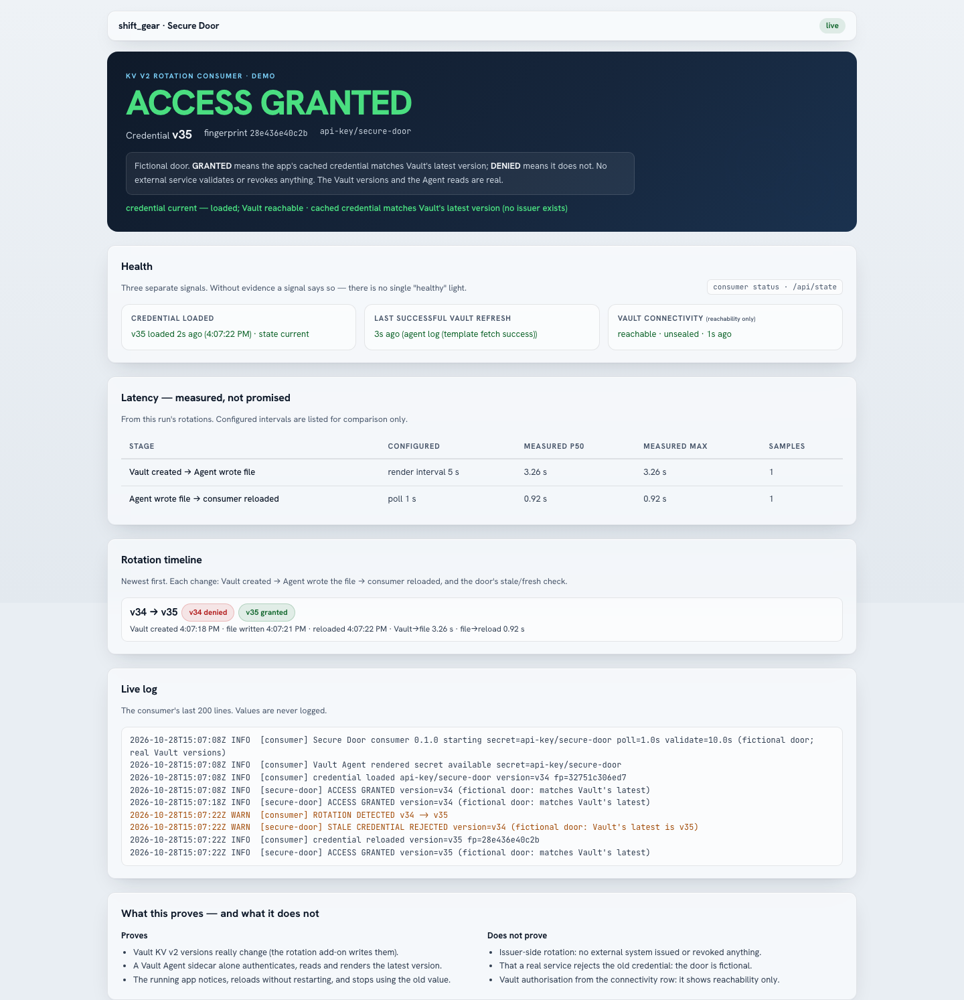
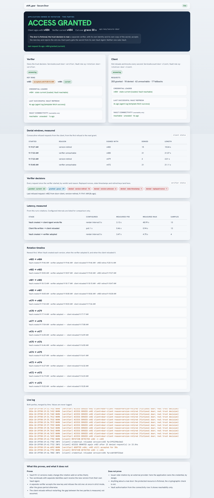

# Rotating KV Secrets Is Easy. Retiring Trust Is the Hard Part.

## Automated application-owned secret rotation on Red Hat OpenShift with Vault Enterprise, Terraform, Ansible, Sentinel and Vault Agent.

> *And you may ask yourself*
> *"Well, how did I get here?"*
> — Talking Heads, *Once in a Lifetime* (1980)

I sent a friend a screenshot of a Vault UI showing version 54 of a secret called `api-key/demo`, with a short message: *"KV rotation. On Red Hat OpenShift. With Vault Enterprise. How hard can it be ;-)"*

KV v2 versions secrets, but it does not rotate the static values stored in it on its own. By the end of that day the screenshot had a controller behind it, three rotation strategies, a Sentinel policy, a compliance report, a page in the Shift Gear console, and a second application whose only job is to keep running while its secret changes underneath it.

The next morning I asked the question I should have started with: who is actually safer because a value in Vault changed? Rotating a KV secret only improves security if the system that validates that secret also adopts the new value and retires the old one. This article is about how one sentence turned into all of that, about the places where the lab told me I was wrong, and about that question.

Shift Gear is my Vault Enterprise lab on OpenShift Local. Terraform builds it, Ansible configures it, and the Vault Secrets Operator delivers secrets to the workloads. The previous article covered the platform. This one adds what KV v2 does not do on its own: rotating the static values stored in it.

---

## What Vault KV v2 does, and what it leaves to you

KV v2 stores a secret and keeps its versions. Every write creates a new version with a `created_time`, the metadata records how many versions to keep, and check-and-set (CAS) lets a writer say "only if the current version is still N". It does not change a value on its own. A static secret in KV stays the same until something writes a new one.

### What Vault already rotates natively

Vault natively rotates credentials and keys for the secret types its engines manage:

- the database secrets engine issues dynamic credentials and rotates the passwords of static roles;
- the PKI secrets engine issues short-lived certificates, so renewal takes the place of rotation;
- Transit rotates its keys without exposing them, and keeps older versions available for decryption and verification;
- every dynamic secret carries a lease, with a TTL, expiry and revocation.

What is left is one class: application-owned static shared secrets stored in KV v2. API keys between your own services, shared HMAC secrets, passwords that only an application knows how to use. In most teams a script rotates those, or nobody does.

I wanted rotation as a capability of the platform, with Vault as the only place the values and their history live.

## Why would anyone rotate a KV value?

I asked this late, after both test suites were green. I put it first here because it decides whether anything below is worth building.

A new KV version changes the system of record, not the relying party. Security only improves when the relying party adopts the new value and retires the old one. Take a third-party SaaS API key. At 09:00 Vault stores key X, and the provider accepts X. At 10:00 a controller writes Y. At 10:01 the Vault Agent hands Y to the application. The provider still knows only X, so the application now fails to authenticate. The stored value rotated, the integration broke, and nothing became safer.

One question sorts this out. Who owns the credential, and who can invalidate it?

- **Vault owns it**, through a secrets engine. Use that engine: the database engine, PKI, Transit. Vault changes the credential where it is checked.
- **An external provider owns it.** The provider has to issue the new credential, so rotation has to go through the provider's API or a connector for it.
- **The application owns it.** It issues the value and its own code checks it, like a shared HMAC secret between two of my own services. Here a new KV version can change trust, because the checking side adopts it and refuses the old one.

If nothing stops accepting the old value, rotating the copy in Vault is inventory hygiene, not trust rotation.

That gave the project a narrower and more honest description: policy-driven rotation and distribution of application-owned static secrets using Vault KV v2 and Vault Agent. The configuration enforces it now. Every secret in `rotation.yaml` declares `owner:`, and only `application` passes. `owner: vault-native` is refused with "use the matching Vault engine instead". `owner: external-provider` is refused with "rotating only the KV copy breaks authentication; the provider must issue the new credential". Terraform, `make rotation-validate` and the controller all check it.

It also moved one secret out of the add-on. My first configuration rotated a session signing key in KV. Rotating that safely needs key identifiers and a ring of old keys for verification, and Vault already has an engine that does exactly that. So `session-signing` became an ed25519 Transit key that Vault rotates every hour, the shortest period Transit allows. Vault created version 1 at 07:41 and rotated to version 2 on its own at 08:41, 60 minutes and 23 seconds later, while it kept version 1 for verification. Transit never hands the private key out. No persona in the lab, operators included, may rotate it by hand; only a root token could, because root bypasses every policy in Vault. I did not want to force every problem into the tool I had just built.

## Five places where rotating a KV secret makes sense

Once I stopped treating KV rotation as a stand-in for the dynamic secrets engines, I found real uses for it. They share one property: the application owns the credential, decides how it is checked, and can stop trusting an old value. I built only one of them, the Secure Door later in this article. The other four are where I would use the same pieces: the controller for the schedule and the history, Vault for storage and versions, Vault Agent for delivery, and the application for the trust decision.

### 1. Internal API keys

Two internal services, both mine. The receiving service accepts an API key from the calling service and checks it against the key it holds. The key lives in KV v2, and both sides get it through Vault Agent.

Every 30 days, say, the controller writes a replacement. Vault Agent delivers it, the receiving service adopts it, and the calling service reloads it without a restart. After a grace period the receiving service stops accepting the old key.

**Why rotate?** A stolen key stops working on a known date instead of never, as long as the receiving service really retires the previous one.

### 2. Webhook signatures with a shared HMAC secret

Two internal applications exchange webhooks. The sender signs each message with an HMAC over a shared secret, and the receiver checks the signature with its own copy. The secret lives in KV v2.

The controller replaces it on a schedule, both applications receive the new value through Vault Agent, and during the change the receiver still accepts signatures made with the previous secret. When the grace period ends, the old secret is retired.

The Secure Door is a small, working version of this case: a client signs requests with HMAC, a separate verifier checks them with its own copy, and in grace mode the previous version stays valid for 30 seconds.

**Why rotate?** Anyone holding a leaked secret can forge messages. Retiring it limits how long that works.

If both applications can call Vault for every message, Transit's HMAC and verify endpoints keep the key inside Vault, and I would choose that first. KV fits when both sides need the key material locally.

### 3. Bootstrap tokens for enrollment

Picture a platform of my own where new workers register with a central service. A worker presents a bootstrap token, and the registration service checks it before it issues the worker its own identity. The token is application-owned and lives in KV v2.

The controller replaces it on a schedule or after a deployment event, and Vault Agent delivers it to the components that handle enrollment. Workers that already registered keep their own identities; only new enrollments need the current token.

**Why rotate?** A bootstrap token grants initial access, so a leaked one is valuable to whoever holds it. A shorter life makes it less so.

For production I would prefer one-time, short-lived enrollment tokens bound to an identity. A rotating shared token is the fallback for an application that cannot do that.

### 4. A legacy application with a shared password

An older internal application authenticates requests with a shared password against its own built-in check. I can change the password it accepts, but the application cannot request dynamic credentials.

KV v2 becomes the one place for that password. A small Vault Agent integration delivers new values to the application's components, and the controller adds the schedule, the policy and the history.

**Why rotate?** The password gets a lifecycle instead of staying the same for years, and the application does not need a redesign first.

One requirement does not bend: the application has to adopt the new password and refuse the old one. Changing the KV entry alone achieves nothing.

### 5. Rotating at once when trust is lost

Incidents do not wait for a schedule. Say a security team finds that an application-owned API key may have been exposed, and the next scheduled rotation is 27 days away.

An operator requests a rotation now, with `make rotation-rotate` or **Rotate now** in the console. The controller writes a new version and records who asked; the request carries the reason. Vault Agent delivers the new value, and the applications adopt it. The verifier then refuses the exposed key, without a grace period when accepting it any longer is too risky. My verifier's strict mode does exactly that.

**Why rotate?** A suspected compromise becomes a controlled change with a record: Vault's version history shows when the replacement was written, and each party's own record shows when it adopted it.

The same controller handles the routine schedule and the urgent request; only the trigger differs.

### What the five have in common

Each one manages how long an application trusts a credential. The controller decides when a replacement is due, Vault stores and versions it, Vault Agent delivers it, and the application decides when the previous value stops working.

## When not to build this

I would not build this when:

- Vault's database engine already owns the credential;
- PKI or Transit already fits the trust model;
- an external provider must issue and revoke the credential;
- the application cannot retire the old value.

The rest of this article is the add-on itself, and then the Secure Door, where I test the second case with a verifier of my own that refuses the old key.

## I cut the scope before I wrote any code

My first design was much bigger. It had connectors that would rotate a credential at the issuing system, consumer applications with dual keys and cut-over, a Postgres database for rotation state, and its own API. I wrote a full prompt set for it.

Then I asked myself what I wanted to show. The answer was smaller: a secret in KV v2 that changes from X to Y to Z on a schedule, with every change visible in the console and on the command line. That is **value rotation inside Vault**. It does not touch any issuer, so there is no external key to revoke. I removed the connectors, the database and the second frontend, and rewrote the prompts.

The smaller scope also got a sharper requirement list:

- schedules configurable per secret *type*;
- rotation by time, by usage and by event;
- enforcement of the rotation policy;
- compliance reporting.

## An add-on that can leave again

Shift Gear's build is thirteen interleaved Terraform and Ansible phases, and a second `make lab` must report every plan empty and every Ansible phase unchanged. I did not want rotation to become phase fourteen. It lives in `addons/rotation/`, in its own namespace, `sg-rotation`, with its own Terraform root and state. I recorded that as an architecture decision before I wrote a line of controller code, because the project's requirements say the root count only changes with an explicit decision.

```sh
make rotation-up      # install, then prove one rotation happens
make rotation-down    # remove; every secret, version and history record stays in Vault
```

The add-on touches the core in a short, written list of places: an include line in the Makefile, the Terraform wrapper, the substrate grep, the lifecycle script and the console. Two more came later: one narrow grant in the platform token's policy for the Sentinel policy, and the Transit signing key, which lives in the core's platform root so that removing the add-on cannot remove it. Everything else in the core stays as it was. With the add-on installed I ran `make lab` twice: the second run converged with every plan empty, and the core gates (verify, the 19-check token boundary, drift and the secret scan) stayed green.

## How the pieces fit

```text
rotation controller (namespace sg-rotation)
  -> reads rotation.yaml: types, schedules, policies
  -> reads KV metadata, the audit stream and Vault events
  -> writes a new KV v2 version with check-and-set
  -> records fingerprint, trigger, time and actor in custom metadata
     (a Sentinel policy refuses any value write that is not this)

Vault Agent (a sidecar in each consuming pod)
  -> logs in with Kubernetes auth
  -> fetches the latest version every five seconds
  -> renders it atomically to a memory-backed file

application / verifier
  -> reloads on a new version
  -> accepts the new value
  -> retires the old one at once, or after a grace period
```

The controller and Vault Agent move the value. Only the last block changes trust.

## One rotation, start to finish

The controller is about 1,500 lines of Python, standard library only. It runs from a ConfigMap on a pinned UBI 9 Python image, so there is no image build. It keeps no state of its own. Every ten seconds it reads Vault and decides again:

1. Find the triggers that are due. If several fire at once, it rotates once and records the highest priority: a request beats an event, an event beats usage, usage beats time.
2. Generate a new value with the type's generator and check that it differs from the current one.
3. Write it with `cas` set to the version it just read. If someone else wrote in between, Vault refuses the write and the controller tries again on the next loop. It never overwrites.
4. Record why. KV v2 custom metadata gets one key per version, `v<N> = fingerprint|trigger|time|actor`, and old keys are pruned along with the versions KV v2 drops.
5. If the controller dies between the write and the record, the next loop finds a version without a record and marks it `recovered`.

The fingerprint is the first twelve hex characters of a SHA-256 over the value. The console, the logs and the compliance report only ever show fingerprints. The command line can print values, with `REVEAL=1`, for a demo:

```text
$ make rotation-history SECRET=api-key/demo
VERSION  FINGERPRINT   EVENT              ACTOR                                  AT
v6       452b2ff1a282  Rotated (request)  cli:raymon.epping via kubernetes exec  2026-10-28T11:16:00Z
v5       def51c72fdda  Rotated (time)     schedule                               2026-10-28T11:15:46Z
v4       71822bf370a5  Rotated (time)     schedule                               2026-10-28T11:14:46Z
v1       929304a12450  Created            controller                             2026-10-28T11:11:19Z
```

The controller holds no Vault token. A Vault Agent sidecar logs in with Kubernetes auth and puts the token on each request through a proxy on loopback.

## Three ways to start a rotation

Rotation policy lives in one file, `rotation.yaml`. A type sets a generator, a schedule, a maximum age, a minimum length and optionally a maximum number of reads. A secret picks a type and can only tighten it. Terraform validates the file at plan time, `make rotation-validate` validates it offline, and the controller validates it again at start-up.

**Time.** The controller compares the current version's `created_time` with the interval. It doesn't keep a timer in memory, so a restarted controller is on schedule immediately. On a 20-second test schedule I measured gaps of 20.3 and 20.4 seconds.

**Usage.** Vault has no read counter per secret. It has an audit stream, and Shift Gear already collects it for its Audit page. The controller counts `read` requests on the managed path, deduplicates them on the audit id and excludes its own reads by display name, which it learns from Vault with `lookup-self`. After three reads of `api-key/demo` the secret rotates with `trigger=usage`. This is an advanced pattern, and I treat it as a best-effort operational trigger: an audit stream records evidence of reads, and a collector can drop entries, so it cannot serve as a canonical counter. If the collector dropped entries, the count is marked *possibly undercounted*. If it cannot be reached, usage shows *not reported* and never triggers a rotation.

**Events.** There are two kinds. A person can request a rotation by writing `rotation_request` into the secret's metadata with their own Vault token, so Vault decides who may ask. And a secret can watch another path, so that an application release, which writes the core `app-config` secret, rotates the secrets that depend on it. Vault event notifications wake the controller within seconds. I measured 3.0 to 5.1 seconds from the `app-config` write to the dependent secret's new version.

An external review of my prompts asked what happens to an event that arrives while the controller is down. Each managed secret stores the version it last saw of every watched path, and the controller compares that checkpoint with the live version on every loop. Events only make it faster. One gap was real: I compared with "greater than", so a watched secret that was deleted and recreated would have restarted at version 1 and been missed. It now triggers on any difference.

So I rely on the three differently. Time is authoritative and always on: every secret must have it. Events are authoritative too, because the checkpoint catches what the notifications miss. Usage can only ever rotate a secret earlier.

## Rules the lab taught me

My first test configuration had a secret with only the event strategy. Its type has a maximum age of 45 seconds, so the compliance report flagged it as overdue, again and again, correctly. Nothing could keep it inside that age. The configuration now refuses a secret without the `time` strategy. Usage and events can only rotate *earlier*.

YAML 1.1 reads the key `on:` as the boolean `true`. My event rules used `on:` until a unit test that parses the shipped configuration complained about a missing key. They now use `match:`.

And the Ansible token, which the project's tooling uses for KV, may only *read* metadata. My plan had the command line mint a short-lived token from a token role in the `shift-gear` namespace. Vault answered: *"root or sudo privileges required to directly generate a token in a child namespace."* `make rotation-rotate` now asks the controller over a loopback-only endpoint through `oc exec`, so Kubernetes RBAC is the authority there. The request still lands in Vault, recorded with the actor `cli:<user> via kubernetes exec`.

## Enforcement, and the test that found my own gap

The first two enforcement layers were straightforward. The controller reconciles drift: change `max_versions` or turn off `cas_required` by hand and it puts them back within one loop, logging `enforced`. Vault ACL lets only the controller's policy write values, while operators get `patch` on the metadata so they can ask for a rotation. They get that through an internal identity group whose members are the existing `oidc-`, `ldap-` and `jwt-operators` groups. I proved the inheritance live by signing in as two personas: cleo got `patch`, ben did not.

Then the live test suite tried every persona against a managed secret. Ada, an engineer, could read the value. The test recorded her capabilities: create, read and update. The core policy `sg-engineer` grants those on `kv/data/shift-gear/*`, and the platform automation token has the same reach. An ACL policy can only add rights. My add-on could not take them away.

That is what Sentinel endpoint governing policies are for, and the lab's licence includes Sentinel. The add-on's Terraform root now renders one EGP, `sg-rotation-kv`, from the same `rotation.yaml`, so the schedule, the generator and the enforcement share one source. It refuses:

- a value write that does not come from the controller. It checks both the controller's policy and the Kubernetes auth metadata of its ServiceAccount, because a policy name alone can be attached elsewhere;
- a value write without check-and-set;
- a value shorter than its type's minimum, or outside the generator's alphabet;
- any metadata change except a patch that touches only `rotation_request`;
- any metadata delete.

Terraform's token had no right to create EGPs. I asked for one narrow grant, `shift-gear/sys/policies/egp/sg-rotation-*`, and got it. A capability check confirms the grant is denied for any other name and in the root namespace. With the EGP live, the platform token, an engineer and an operator tampering with settings all get a 403. So does the controller itself when a test hook makes it write an eight-character value. An operator's rotation request still goes through. Root tokens are exempt from EGPs and reads are not governed; I wrote both limits into the decision record.

## A compliance report that still works when the controller is down

`make rotation-report` checks each secret against its type: age within the maximum, reads within the limit, the configured history retained, CAS on, and a rotation record for every retained version. The report reads Vault directly, without asking the controller.

That design choice is what the test checks. The suite scales the controller to zero, waits past the shortest maximum age and runs the report again. The overdue secret turns non-compliant with the reason `overdue: age … > max_age 45s`. After the controller comes back, the secret rotates and is compliant again within two loops. A report that depended on the controller would have stayed green.

## Engines › Rotation in the console

The Shift Gear console got a page under Engines. It shows the secrets, their version timeline with fingerprints and triggers, compliance per type, and the policies from `rotation.yaml`. **Rotate now** appears only when Vault grants you `patch`, and the page says "rotated" only after Vault shows the new version. The page never receives a value; a Playwright test reads the current value from Vault and checks that it is absent from the page.

My first version showed every persona "history denied by Vault". I had read Vault's `sys/capabilities-self` answer at the top level, and this Vault version puts it under `data`. Every capability looked empty. The test suite found it before anyone else did.

## The first Secure Door: delivering the new version

Rotation inside Vault proves half the story. The other half is an application that reads the secret, notices a new version and carries on without a restart. I built that as a separate add-on with its own namespace, the **Secure Door**. The first version was one pod with four containers.

- `vault-agent` is the only container that talks to Vault. Its projected ServiceAccount token is mounted into that container alone. It has no sink and no listener, so its Vault token never touches disk. It renders the secret and its version into one atomic JSON file on a memory-backed volume.
- `vault-probe` checks Vault's unauthenticated status every five seconds, as an explicit connectivity signal.
- `consumer`, Python again, reads the rendered file every second, reloads on a new version and runs a fictional door.
- `board`, a dependency-free Node server, serves a page in the same design as the console.

The core workloads get their secrets from the Vault Secrets Operator. For the Secure Door I chose a Vault Agent sidecar instead: it logs in from inside the pod with that pod's own identity, replaces one rendered file in a single atomic step, and leaves the application nothing to do but reload a file. The application needs no Vault client of its own.

The door is fictional, and every surface says so. GRANTED means the app's cached value matches Vault's latest version; DENIED means it does not. No external service validates or revokes anything. On every rotation the console log shows the sequence:

```text
WARN  [consumer]    ROTATION DETECTED v27 -> v28
WARN  [secure-door] STALE CREDENTIAL REJECTED version=v27 (fictional door: Vault's latest is v28)
INFO  [consumer]    credential reloaded version=v28 fp=…
INFO  [secure-door] ACCESS GRANTED version=v28 (fictional door: matches Vault's latest)
```

It watches its own secret, `api-key/secure-door`. My first draft pointed it at `api-key/demo`, which rotates after three reads. A Vault Agent re-reading it every five seconds would have rotated it constantly.

[](screenshots/09/secure-door-desktop.png)

The same external review pointed out that the age of the rendered file says nothing about the Agent's health. The Agent rewrites the file only when the secret changes. So the board shows three separate signals, each with its own evidence: when the consumer loaded its credential, when the Agent last fetched successfully from Vault (its trace log records every fetch), and whether Vault is reachable (the probe). Without evidence, a signal reads "unknown".

The latency on the board is measured. Across two test runs, the Agent fetched six to seven times per 30 seconds, so it really used the five-second interval I configured. From Vault's `created_time` to the Agent's file took a median of 1.6 to 2.5 seconds, with a maximum of 4.4. From the file to the consumer's reload took a median of 0.44 to 0.63 seconds. Four rotations went by with the same container start time. When I stopped the consumer through three rotations, it reported `missed 3` on restart.

## The bug the tests passed

After the first full test run passed, I looked at the board's screenshots. Vault connectivity said *unreachable*, while the refresh signal said the Agent had fetched three seconds earlier.

I had given the probe a three-second client timeout to shorten its detection time, which my test had measured at 34.6 seconds. `vault status` has no `-client-timeout` flag. The CLI printed the error to standard error, which the probe discarded, and every check since had returned exit code 1. The tests passed because they accepted any connectivity value on the board. `VAULT_CLIENT_TIMEOUT=3s` as an environment variable works, and the probe now detects a cut-off in 6.9 seconds. The tests now require *reachable* at baseline before anything else is checked.

## The second Secure Door: a verifier that says no

The first door compared the app's value with Vault's latest version. That proves delivery. Nothing in it could refuse an old value on its own, because the door asked Vault what was current, and no real verifier does that. So I split it into two parties, each in its own pod with its own Vault Agent, ServiceAccount, Kubernetes auth role and read-only policy on the one secret.

- `door-verifier` owns the trust decision. It keeps the versions it accepts in a key ring in memory.
- `door-client` hot-reloads the secret, as before, and asks the verifier to open the door every second.
- The board reads both parties' status pages and nothing else.

Vault Agent does a lot in this design: it logs in, fetches the secret and renders it. It does not decide when an application stops accepting the old value. That decision belongs to the verifier, and it is what this door tests.

No secret crosses the network. The client sends the key version, a timestamp, a random nonce, and an HMAC-SHA256 over them, made with the secret. The verifier recomputes it with its own copy. It refuses a timestamp more than 30 seconds off, a nonce it has already seen, a version newer than its own, a version no longer in its ring, and a bad signature, and every answer names the reason. The door is still fictional, but the trust decision is real.

The cut-over is a verifier setting. In strict mode the previous version is refused the moment the verifier adopts the new one. In grace mode, the default, the previous version stays valid for 30 seconds.

I expected strict mode to show a short failure window on every rotation. The test measured something else. The two Agents fetch independently, every five seconds, so either party can see a new version first. In eight strict rotations the client's Agent was first seven times, by half a second to a second and a half. The verifier answered `version-unknown`, the client signed again with the previous key it still held, and the door opened, with zero refusals. Once, the verifier was first, by 3.6 seconds. The client was refused three times with `version-retired`, a window of 3.01 seconds, and then granted again by the same process. A strict cut-over does cause real failures, but only while the verifier is ahead, and only for as long as the other Agent lags.

Grace mode had zero refusals over two rotations. Then the test checked that the old key still loses:

- a request signed with the old key, five seconds after its grace ended: refused, `version-retired`;
- a request with a timestamp 60 seconds old: refused, `stale-timestamp`;
- the same signed request sent twice: granted, then refused, `replayed-nonce`.

Grace has limits, and the test measured those too. It removed the client's NetworkPolicy allowance to Vault, so its Agent could not fetch, and rotated. The client kept the old key and was granted for 30.1 seconds, the length of the grace, and then refused 15 times until its Agent could reach Vault again. And grace lives in the verifier's memory: after a restart its ring held only the current version, so a client still on the previous one was refused straight away. The board shows all of it: both lanes, the key ring with the time the previous version expires, every refusal by reason, and each denial window with its length.

[](screenshots/09/secure-door-two-parties-desktop.png)

Two things in my own tests were wrong before any of these numbers were. The parties first wrote their times in whole seconds. That made the verifier and the client look simultaneous, and once put an adoption 0.21 seconds before Vault had created the version. They write milliseconds now. And my "same process" check compared PIDs, which inside a container is always 1, so it could never fail. It compares the process start time now. The first door's check had the same hole; its container start time was the part doing the work.

## Removing it again

The suite's remove-and-re-add scenario runs `make rotation-down`, checks that every managed secret still has the same versions and the same history records, checks the core Terraform roots for drift, then runs `make rotation-up`. Rotation resumes with no gap in the version numbers. In the controller's log after the re-install, the line where it learns its own identity comes before its first write. A second `make rotation-up` reports no Terraform changes, no Ansible changes and the same controller pod.

At the end I recorded the whole promise as one sequence instead of trusting the separate runs. I removed both add-ons and ran `make lab` twice: the core converged on its own, with 157 console tests passing and the 12 that need the add-on skipped. `make rotation-up` took 86 seconds, and a second run changed nothing. Three minutes later `api-key/demo` had moved from v811 to v814, and `REVEAL=1` showed 20 values, each matching the fingerprint Vault had recorded for its version. Both suites passed, and `make lab` stayed clean twice with the add-ons installed. After `make down && make up` both add-ons came back, and the history continued from v841 to v842. Then I removed the rotation add-on again, waited until the secrets were past their maximum age, and ran the report: `controller: not installed`, one of three compliant, `overdue: age 920s > max_age 300s`. After `make rotation-up` the version numbers picked up where they had stopped.

The full controller suite passes 13 of 13 scenarios plus a leak check, which looks for 113 secret values across 601 places: logs, status endpoints, Terraform state, build output and the working tree. The Secure Door suite passes 10 of 10 scenarios plus its own leak check, 20 values across 607 places. The core console tests pass 169.

## What it does not do

This is value rotation of secrets the application owns. Nothing outside Vault learns about a new value unless the application's own verifier reads it, as the Secure Door's does. It does not rotate a credential at a provider, and its configuration refuses a secret that would need that. Root tokens can still write a managed secret, and engineers can still read one. NetworkPolicies are pod-scoped, so a party's main container could open a TCP connection to Vault; it has no token to use on it. The add-on is built for Shift Gear on OpenShift. The controller has no OpenShift code in it, but the Podman version for my Red Pass lab is still a separate piece of work.

## What broke while building it

- The day started with `make up` failing, because the platform's bootstrap tokens had expired during a six-day pause. The seal agent's AppRole then locked itself out with an expired secret-id, a lockout the Terraform variables had meant to cap at 30 seconds and never applied. So the first rotation bug I fixed that day was in the platform itself.
- A Node program mounted from a ConfigMap never started. ConfigMap files are symlinks, so `import.meta.url` never equalled the path it was started with.
- Restricted pods run every container as the same UID, so file permissions cannot separate containers in one pod. Isolation comes from which container mounts what.
- The controller's scan for secrets that left the configuration ran when its loop counter said 1. The first loop is the one that waits for Vault, so the old signing secret stayed "managed" for five minutes. It now runs on the first loop that reaches Vault.
- After seven days of uptime, OpenShift's Multus network plugin kept stale credentials. Running pods were fine, but every new pod in the cluster stayed in `ContainerCreating` with `Unauthorized`. Restarting the Multus pod fixed it.
- The recorded sequence found a bug in `make up` itself. When the agent demo was still backing off after a start, the script ran `oc rollout restart`. That writes an annotation into a Deployment Terraform owns, and `make drift` reported it. The script now deletes the pod instead.

---

## Close

```sh
make rotation-test && make rotation-consumer-test
```

```text
rotation-test: 13 passed, 0 failed — evidence .build/addons/rotation/rotation-test.json
rotation-consumer-test: 10 passed, 0 failed — evidence .build/addons/rotation/consumer-test.json
```

The screenshot I sent my friend showed version 54. While I wrote this, `api-key/demo` passed version 900.

My message asked how hard it could be. The easy part was writing new versions into Vault. The hard part was proving that something meaningful stopped trusting the old one. In the Secure Door my own verifier does that, and the tests measure how long it takes.

---

**The labs:**

- Shift Gear: [https://github.com/raymonepping/shift_gear](https://github.com/raymonepping/shift_gear)
- Golden Ticket: [https://github.com/raymonepping/golden_ticket](https://github.com/raymonepping/golden_ticket)
- Red Pass: [https://github.com/raymonepping/red_pass](https://github.com/raymonepping/red_pass)
- Multi Pass: [https://github.com/raymonepping/multi_pass](https://github.com/raymonepping/multi_pass)
