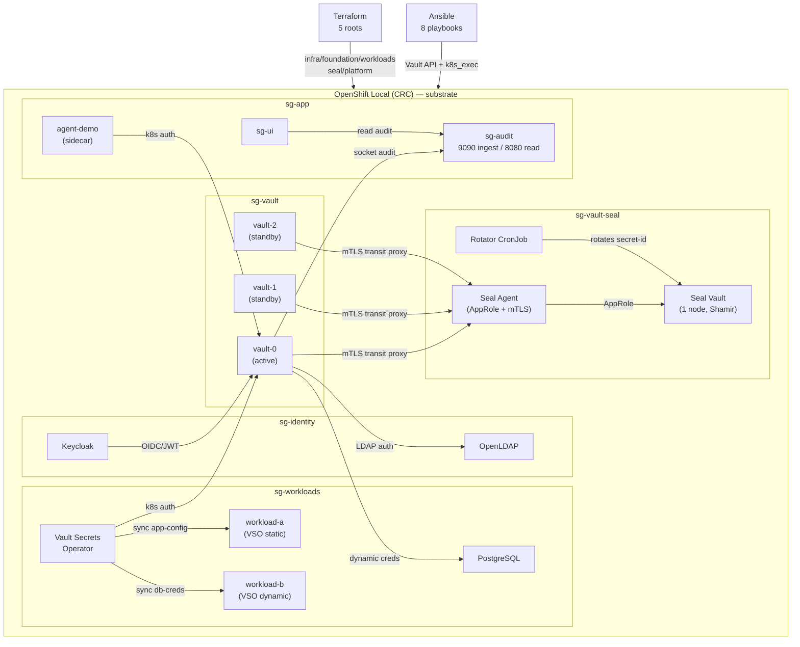

# Architecture

Shift Gear runs on a single OpenShift Local (CRC) instance. Three concerns, three tools:

- **Terraform** — everything with an API and a lifecycle: Kubernetes objects, Helm releases,
  Vault structure (namespaces, mounts, policies, token roles, audit devices).
- **Ansible** — everything with an order and a moment: init, unseal, credentials, people,
  seeds, proofs. Never creates infrastructure; configures it after Terraform declares it.
- **Vault Secrets Operator** — runtime secret delivery to workload pods. No Vault token in the application containers receiving VSO secrets.

---

## Namespaces

| Namespace | Owner | Contents |
|---|---|---|
| `sg-vault-seal` | tf workloads | Seal Vault (1 node, Shamir), seal agent, rotator |
| `sg-vault` | tf workloads | Vault Enterprise ×3 (Raft HA), transit-sealed |
| `sg-identity` | tf workloads | OpenLDAP, Keycloak |
| `sg-workloads` | tf workloads | workload-a (VSO static), workload-b (VSO dynamic), PostgreSQL |
| `sg-app` | tf workloads | agent-demo (Vault Agent sidecar), sg-ui (Nuxt + Nitro BFF), sg-audit collector |
| `openshift-operators` | tf foundation | Vault Secrets Operator (CSV) |
| `sg-rotation` (add-on) | addons/rotation/terraform | KV rotation controller (controller + vault-agent + vault-events); present only after `make rotation-up` ([rotation](rotation.md), D17) |

The five project namespaces are created by `terraform/foundation/`. The VSO Subscription is in
the existing `openshift-operators` namespace; the operator is cluster-scoped.

---

## Seal chain

The cluster pods carry no seal-Vault token. They call the seal agent over mTLS;
the agent authenticates to the seal Vault with AppRole and proxies Transit calls.

```text
Vault cluster (sg-vault), three Raft nodes
  -> mTLS -> seal-agent.sg-vault-seal.svc:8200
  -> AppRole-authenticated proxy -> seal Vault Transit key autounseal

seal-rotator CronJob: every six hours, replaces the agent secret-id
```

**No seal token on the cluster.** The cluster Vault pods unseal themselves via the transit
seal stanza in their Helm values. The seal agent's AppRole authenticates to the seal Vault — not
to the cluster Vault.

---

## Vault HA topology

Three `vault-N` pods form an integrated Raft cluster:

```
vault-0  (active leader — elected by Raft)
vault-1  (standby voter)
vault-2  (standby voter)
```

All three are in `sg-vault`. Traffic reaches them through a single Route
(`vault.apps-crc.testing`, TLS passthrough) that balances across the `active=true` pod via a
Kubernetes `Service` in `ClusterIP` mode — the load balancer routes to the active node directly
(Vault redirects standbys).

The enterprise namespace is `shift-gear`. All mounts, policies, auth methods, and secrets live
there, apart from root-level bootstrap and audit operations. Calls to the seal Vault and root-level cluster endpoints use the root namespace; platform calls explicitly select `shift-gear`.

---

## Ownership table

| Resource | Created by | Configured by | Delivered by |
|---|---|---|---|
| Kubernetes namespaces | tf foundation | — | — |
| Routes, Services | tf foundation/workloads | — | — |
| Vault Helm releases | tf workloads | — | — |
| VSO Subscription | tf foundation | Operator Lifecycle Manager | — |
| Audit collector + socket/file devices | tf workloads/platform | — | — |
| OpenLDAP, Keycloak Deployments | tf workloads | ansible identity | — |
| Vault init + unseal keys | — | ansible seal-init, bootstrap | — |
| Bootstrap tokens | — | ansible seal-init, bootstrap | — |
| Vault mounts + policies | tf seal, platform | — | — |
| Auth methods | — | ansible configure, identity | — |
| KV secrets, DB credentials | — | ansible configure | — |
| User accounts + groups | — | ansible identity | — |
| VSO resources (CRDs) | tf workloads | — | vso |
| App Secrets (runtime) | — | — | vso |
| Vault Agent sidecar secrets | — | — | vault-agent |

---

## Tool boundary (Vault-enforced)

Four bootstrap tokens, each with a distinct capability set:

| Token | May | May not |
|---|---|---|
| `sg-tf-seal` | Create transit mount, autounseal key, AppRole roles | Mint secret-id, write policy |
| `sg-ansible-seal` | Mint secret-ids, read role-ids | Create mount, write policy |
| `sg-tf-platform` | Create mounts, write policies, token roles, audit | Enable auth methods, write KV data |
| `sg-ansible-platform` | Enable auth methods, write KV data, mint DB credentials | Create mount, write policy |

Verified by `make boundary` (19 `sys/capabilities-self` checks). See
[security model](security-model.md) for the full boundary rationale.

---

## VSO flow

```
VaultConnection (sg-workloads)
  └── address: https://vault.apps-crc.testing
      cacert: CA ConfigMap

VaultAuth (sg-workloads)
  └── method: kubernetes
      serviceAccount: vso-workloads
      policy: sg-vso (in shift-gear namespace)

VaultStaticSecret (sg-workloads)
  └── mount: kv
      path: shift-gear/config/app-config
      destination Secret: app-config

VaultDynamicSecret (sg-workloads)
  └── mount: database
      path: creds/demo-reader
      destination Secret: db-creds
      renewalPercent: 67

Secret: app-config (sg-workloads)
  └── mounted read-only into workload-a pod

Secret: db-creds (sg-workloads)
  └── mounted read-only into workload-b pod
```

No Vault token in the VSO application containers. The VSO operator authenticates with Kubernetes auth using the
projected service account token of the `vso-workloads` SA.

---

## Agent demo

`sg-app/agent-demo` pod has two containers beyond the application:

1. **`vault-agent-init`** (init container) — writes `demo-secret` to `/vault/secrets/` before the
   app starts.
2. **`vault-agent`** (sidecar) — renews its token and refreshes the KV template.

Auth method: Kubernetes (`sg-agent-demo` role, `sg-app` namespace, `sg-agent-demo` SA).
Policy: `sg-agent-demo` (read `kv/data/shift-gear/agent/demo-secret`).

The application container reads `/vault/secrets/demo-secret` directly — no Vault API call,
no Vault token, no environment variable. The Agent token sink uses a separate
memory volume mounted only by the init container and sidecar; rendered secrets
use their own memory volume. `make verify` checks the application cannot see
either the old shared sink path or the isolated sink path.

---

## Audit

Terraform `platform` enables both audit devices at the root namespace:

| Device | Destination | Notes |
| --- | --- | --- |
| `file/` | stdout | OpenShift log collection; remains available during collector restarts |
| `socket/` | `sg-audit.sg-app.svc:9090` | TCP JSON lines to the Terraform-owned collector |

`sg-audit` runs in `sg-app` on a pinned UBI Node.js image with a ConfigMap-mounted
program, so it needs no image build. A source checksum rolls the Deployment.
It projects entries into a 1,000-entry in-memory buffer; it exposes `GET /audit`
and `GET /healthz` on HTTP 8080. `sg-audit-ingress` allows 9090 only from Vault
pods and 8080 only from `sg-ui`. The BFF requires a signed-in session for reads.
The file device keeps requests working while the socket endpoint restarts.

---

## NetworkPolicies

Policies select particular pods and restrict their ingress; the repository does
not declare a namespace-wide default-deny or restrict egress.

| Target | Allowed inbound traffic |
| --- | --- |
| Seal agent | Vault pods in sg-vault, 8200 |
| Seal Vault | Seal agent, rotator and OpenShift router, 8200 |
| Vault cluster | Vault peers on 8200/8201; router and sg-workloads, sg-app, openshift-operators on 8200 |
| Keycloak proxy | Router and Vault pods, 8444; forwards locally to Keycloak 8443 with certificate verification |
| OpenLDAP | Keycloak and Vault pods, 1389 |
| PostgreSQL | workload-a/b and Vault pods, 5432 |
| Audit collector | Vault pods on 9090; sg-ui on 8080; rotation controller on 8080 (add-on, additive policy `sg-audit-allow-sg-rotation`) |
| Vault cluster (add-on) | rotation controller in sg-rotation on 8200 (additive policy `allow-sg-rotation`) |
| Rotation controller (add-on) | sg-ui on 8080 only (read-only status); default-deny for the rest of sg-rotation |

Workload-a/b and sg-ui have no selecting ingress policy. These are lab
boundaries; they do not establish namespace-wide network isolation.

---

## System diagram



See also: [`docs/frontend/DESIGN.md`](frontend/DESIGN.md) for the console UI design.

## Add-ons

Add-ons are removable extensions with their own Terraform root, namespace
and make targets. They are not in `scripts/phases.txt`, not in the
convergence digest, and change no core object.

| Add-on | Install / remove | Owns | Document |
| --- | --- | --- | --- |
| KV v2 value rotation | `make rotation-up` / `make rotation-down` | `sg-rotation`, policies `sg-rotation-*`, two additive NetworkPolicies, the controller's Kubernetes auth role and two internal identity groups; the controller is the runtime writer of `kv/shift-gear/rotation/**` | [rotation.md](rotation.md) |

---

## Selected Should extensions

The console keeps its published snapshot sources and adds an independent bounded observation adapter for Seal Vault and all three main members, identity discovery and five named Kubernetes status resources (the existing four VSO/consumer resources plus the seal Agent deployment). The seal-chain indicator and diagrams use shared foreground sampling every 15 seconds and expire observations after 30 seconds, independently of snapshot publication. A dedicated projected service-account identity has GET-only named access, without Secret reads or mutation. See [runtime observation](runtime-observation.md).

The six-field `cluster` connection output remains unchanged. Infra now also publishes `images.cli` as dependency metadata, resolved from the cluster's CLI ImageStreamTag; workloads consume its immutable reference. This additional output is a required dependency for the updated workloads root, separate from connection discovery. See [dependency operations](dependency-operations.md) for version/image ownership and upgrade custody.
