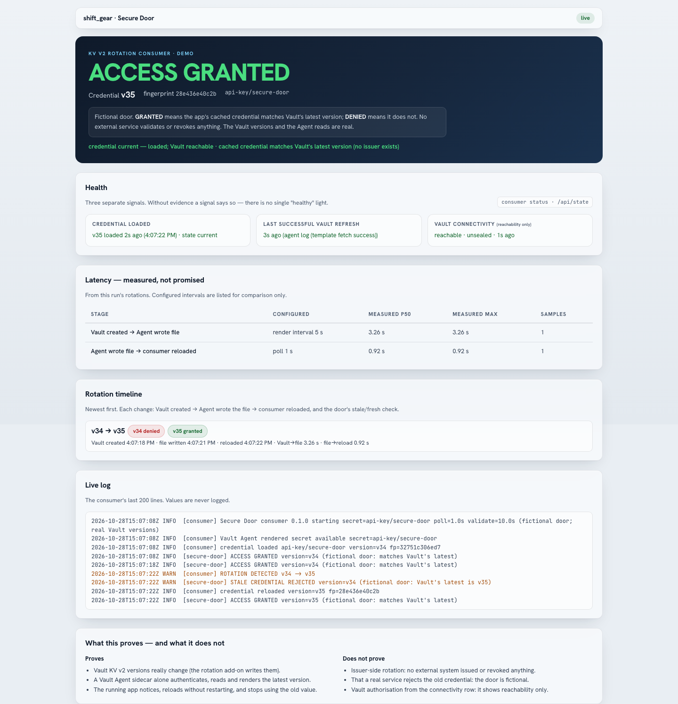

# KV v2 value rotation (add-on)

Vault KV v2 stores and versions static secrets, but it does not rotate them. This
removable add-on does. A small controller generates cryptographically secure
values and writes each one to the existing `kv` mount as a new KV v2 version,
with check-and-set. It decides *when* from a declarative policy per secret
type, and records *why* next to every version.

```text
make rotation-up                              # install and prove it rotates
make rotation-history SECRET=api-key/demo     # v1 -> v2 -> v3 … with fingerprints and triggers
make rotation-down                            # remove; every secret, version and record stays in Vault
```

Decision record: [D17](decisions.md#d17--the-rotation-add-on-kv-v2-value-rotation-as-a-removable-sixth-terraform-root).
Code: [`addons/rotation/`](../addons/rotation/README.md).

## The boundary: value rotation, not issuer rotation

This add-on replaces values **inside Vault**. It does not change a credential
at the system that issued it, so there is no target to update, no consumer to
cut over and no old key to revoke. Vault's own engines already do
issuer-side rotation: database credentials (dynamic and static roles), PKI
certificates and Transit keys. The add-on covers static values those engines
cannot, and the console says so.

Three rules hold throughout:

1. **Vault is the only store.** Values, versions and rotation history live in
   KV v2: data, version metadata and custom metadata. The controller keeps
   no state, so removing or restarting it loses nothing.
2. **A value never leaves Vault except to an authorised reader.** Logs,
   `.build/`, Terraform state, git and the console see only **fingerprints**:
   the first 12 hex characters of SHA-256 over a value of at least 128
   bits. Only the CLI prints values, and only with `REVEAL=1`.
3. **Add-on means add-on.** `make rotation-down` removes the controller and
   its configuration. Every managed secret, every version and all history
   stay in Vault.

## Architecture

```text
             rotation.yaml ──(Terraform ConfigMap, validated)──┐
                                                               ▼
sg-rotation  rotation-controller pod: [controller (Python stdlib)] [vault-agent] [vault-events]
               │ loopback api_proxy               │ Kubernetes auth   │ vault events subscribe kv-v2/*
               └──────────────────────────────────► Vault (namespace shift-gear)
                                                    kv/shift-gear/rotation/<type>/<name>
                                                    data: value (v1, v2, …)   custom metadata: history
               ┌──── KV reads (usage) ──── sg-audit collector (sg-app :8080)
sg-app       sg-ui BFF ── person's own token ──► Vault (history, rotation_request)
                       └─ /status /compliance ──► controller :8080 (read-only, non-secret)
```

- **The controller container holds no Vault token** and no `VAULT_*`
  variable. Its `vault-agent` sidecar logs in with Kubernetes auth and injects
  the token through an `api_proxy` on loopback. The token sink is shared only
  with the `vault-events` sidecar.
- **Code without a build.** The code is mounted from a ConfigMap and runs on a
  pinned UBI 9 Python image (the D15 pattern). There is no image build and no
  registry entry.
- **Its own namespace and Terraform root, outside the 13 phases.** Two
  *additive* NetworkPolicies let the controller reach Vault and the audit
  collector. No core object is modified.

### One rotation

1. **Decide.** Find the triggers that are due (below). Several due at once
   produce one rotation, recorded under the highest priority:
   request > event > usage > time.
2. **Generate.** Use the type's generator. The new value must differ from the
   current one by fingerprint and meet the type policy.
3. **Write.** Store `{value}` with `options.cas = <current version>`. A CAS
   conflict means someone else wrote: the controller skips and decides again
   on the next loop. It never overwrites.
4. **Record.** Patch custom metadata with `v<N>`
   (`<fingerprint>|<trigger>|<time>|<actor>`) and the summary keys, then
   prune records of versions KV v2 no longer keeps.
5. **Recover.** If the controller stops between write and record, its next
   loop records the version as `trigger=recovered`. The version history never
   has a gap or a duplicate.

## Configuration: `addons/rotation/rotation.yaml`

```yaml
rotation:
  mount: kv
  prefix: shift-gear/rotation          # managed secrets: kv/<prefix>/<type>/<name>
  loop_seconds: 10
  defaults: { max_versions: 20 }       # history retention per secret (KV v2 max_versions)
  types:
    api-key:
      generator: { kind: chars, charset: alnum, length: 32 }
      schedule:  { interval: 60s }      # demo-short; production would use days
      policy:    { max_age: 5m, min_length: 32, max_reads: 5 }
  secrets:
    - name: demo                       # SECRET=api-key/demo
      type: api-key
      strategies: [time, usage, event]
      usage: { max_reads: 3 }          # may tighten the type, never loosen it
    - name: session-signing
      type: signing-key
      strategies: [time, event]
      events:
        - { match: "kv-v2/data-*", path: shift-gear/config/app-config }
```

**Generators:**
- `chars`: alnum, alpha, hex or lower;
- `bytes`: base64url or hex;
- `password`: length plus the classes lower, upper, digit and symbol, with at
  least one character of each class.

Every generator has an entropy floor of 16 characters or 16 bytes.

**Validation** runs three times: Terraform preconditions at plan time,
`make rotation-validate`, and the controller at start-up. These are refused:
- an interval longer than `max_age`;
- a per-secret override that loosens its type (interval or `max_reads`);
- a generator that cannot meet `min_length`;
- a secret without the `time` strategy. Every type has a `max_age`, and usage
  or events can only rotate *earlier*;
- `usage` without `max_reads`;
- an event rule that watches the managed prefix (it would loop);
- more than 8 event rules per secret, or a version checkpoint over 480
  bytes (custom metadata values hold 512);
- `max_versions` above 50 (64 custom metadata keys, minus the 10 summary
  keys).

## Strategies

| Strategy | Fires when | Source of truth |
| --- | --- | --- |
| **time** | the current version's `created_time` is older than the interval | KV v2 version metadata |
| **usage** | reads since the last rotation reach `max_reads` | the Vault audit stream, through the `sg-audit` collector: `type=request`, `operation=read` on the managed data path, deduplicated on the audit id, excluding the controller's own reads (by display name, learned from `lookup-self`). If the collector dropped entries, counts are flagged *possibly undercounted*; if it is unreachable, usage shows *not reported* and never triggers. |
| **event: request** | someone wrote `rotation_request` (custom metadata) and it has not been served yet | Vault decides who may ask (`patch` on the managed metadata path). The console writes it with the person's own token. `make rotation-rotate` goes through the controller's loopback-only endpoint via `oc exec`, so its authority is Kubernetes RBAC and its actor reads `cli:<user> via kubernetes exec`. Each request id is served once. |
| **event: Vault event** | a watched path has a different version from the checkpoint the secret stores | `rotation_watch = <path>@<version>` in the managed secret's own metadata. Events only wake the controller sooner: a write made while it was offline, or a watched secret deleted and recreated, is still detected on the next loop. The checkpoint advances only when a rotation is recorded. |

Measured on 2026-10-28:
- event cascade, live mode: 3.0–5.1 s from the core `app-config` write to the
  dependent secret's new version;
- time cadence: 20.3–20.4 s gaps on a 20 s test schedule.

## Enforcement

| Layer | What it guarantees | Status |
| --- | --- | --- |
| Reconciliation | `max_versions`, `cas_required` and the type and strategy markers follow the configuration. Drift is corrected within one loop and logged as `enforced`. | built (proven by `rotation-test` s05) |
| Vault ACL | Only the controller identity writes values under the prefix (`sg-rotation-controller`). Operators may only patch metadata (`sg-rotation-operator`, via the internal group `sg-rotation-operators` whose members are the `oidc-`, `ldap-` and `jwt-operators` groups). Auditors read history. | built (s06) |
| Sentinel EGP `sg-rotation-kv` ([D18](decisions.md)) | Refuses any value write not from the controller's ServiceAccount (its policy *and* its Kubernetes auth metadata), a write without CAS, a value outside its type's minimum length or alphabet, any metadata change except a `rotation_request`-only patch, and any metadata delete. | built, hard-mandatory (s12) |

**Why the Sentinel layer is needed.** Two broader core grants also reach the
managed prefix: the core policy `sg-engineer` and the platform automation
token `sg-ansible-platform` (create, read and update on
`kv/data/shift-gear/*`). An ACL can only add rights, never narrow these. The
EGP refuses their *writes*; `rotation-test` s12 shows a 403 for both, for an
operator tampering with settings, and for the controller itself writing a
too-short value. *Reads* are not governed: engineers may still read managed
values, per the core design. Root tokens are exempt (break-glass).

## Compliance reporting

`make rotation-report` (`.build/addons/rotation/compliance.{json,md}`) and the
console's Compliance panel check each secret against its type policy:

- age within `max_age`;
- reads within `max_reads` (missing data is a *warning*, not a violation);
- retained versions as configured;
- `cas_required` on;
- managed marker present;
- every retained version carries a rotation record.

**The CLI report reads Vault directly**, so it stays honest while the
controller is down: secrets past `max_age` turn non-compliant (`rotation-test`
s07), and they return to compliant within two loops of the controller coming
back.

## Lifecycle

| Target | Does |
| --- | --- |
| `make rotation-up` | preflight (Vault active, both platform tokens live — otherwise "run `make up` first") → Vault configuration (Kubernetes auth role, internal groups) → Terraform → proof (pod ready, identity learned, every secret onboarded and enforced, one rotation observed, operator inheritance proven) |
| `make rotation-down` | Terraform destroy (namespace, controller, policies, NetworkPolicies) → remove auth role and groups → print what was kept → core drift check |
| `make rotation-status` | controller state, events mode, usage availability, and every secret's version, fingerprint, trigger, next time and compliance |
| `make rotation-history SECRET=… [REVEAL=1]` | the version history; `REVEAL=1` prints values (demo only, with a warning) |
| `make rotation-rotate SECRET=… [REASON=…]` | request a rotation and wait for the new version |
| `make rotation-read SECRET=…` | one read, for the usage demo (prints the fingerprint) |
| `make rotation-report` | compliance report |
| `make rotation-logs [C=agent\|events] [F=1]` · `rotation-plan` · `rotation-restart` | operations |
| `make rotation-validate` | offline gate: 47 unit tests, 7 Terraform test runs, config, Terraform fmt/validate/test, ansible-lint, ShellCheck (also in CI) |
| `make rotation-test [S=nn]` | live proof, below |

`make rotation-proof` is unrelated: it proves the **seal agent's** AppRole
secret-id rotator.

**`make down` / `make up`** scale the controller down before Vault and back up
after `sg-app`. **`make reset`** deletes `sg-rotation` along with the other
namespaces.

**A second `make rotation-up` changes nothing.** The Terraform plan is empty,
every add-on play reports `changed=0`, and the controller pod is not
restarted (s11).

## Live proof: `make rotation-test`

The suite applies a test overlay: three `rt-*` secrets on a 20 s or 10 min
cadence, a 5 s loop, and a 10 s crash window on one secret. It restores the
normal configuration at the end.

| # | Proves |
| --- | --- |
| s01 | time-based rotation on each type's own cadence |
| s02 | usage-based rotation after N audited reads; the controller's own reads are not counted |
| s03 | a CLI request is served once, with the actor recorded |
| s04 | a Vault event on a watched core path rotates its dependent (latency recorded) |
| s05 | tampered metadata is reconciled |
| s06 | the ACL matrix per persona (cleo, ben, ada, finn), plus the recorded core-grant gap |
| s07 | the compliance report while the controller is down, and its recovery |
| s08 | a crash between write and record leaves no gap and no duplicate (`recovered`) |
| s10 | a watched path written while the controller is offline still triggers |
| s09 | down → up: versions and history unchanged, rotation resumes, identity learned before the first write |
| s11 | a second deployment is idempotent (Terraform, Ansible, pod) |
| s12 | Sentinel: platform token, engineer and operator tampering refused; the controller's too-short value refused; a request still allowed |
| leak | no managed value in logs, `/status`, `/compliance`, Terraform state, `.build/` or the working tree |

Evidence: `.build/addons/rotation/rotation-test.json`. Demo scenario:
[`scenarios/10_kv_rotation`](../scenarios/10_kv_rotation/README.md).

## Console: Engines › Rotation

The page appears under Engines while the add-on is installed. Its sections:
- the hero, with managed count, compliance %, next rotation and events mode;
- Compliance per type, with reasons;
- the managed-secrets table, with an expandable version timeline (v*N* ·
  fingerprint · trigger · time · actor);
- **Rotate now**, shown only when Vault grants you `patch`. The page reports
  "rotated" only when Vault shows the new version;
- the rotation policies per type.

No value ever reaches the browser; Playwright asserts this. With the add-on
removed, the nav item disappears and the page says "not installed", while
history the person may read is still shown from Vault.

| Persona | History | Rotate now |
| --- | --- | --- |
| cleo, dirk (operators) | yes | yes |
| finn (auditor) | yes | no |
| ada (engineer) | yes (core `sg-engineer` reads `kv/metadata/shift-gear/*`) | no |
| ben (staff) | denied by Vault | no |

## Consumer demo: Secure Door (prompt 01_09)

The rotation add-on changes values inside Vault. The **Secure Door** consumer
shows the other side: an app that keeps running while its secret rotates. It
notices each new KV v2 version, reloads it without restarting, and shows the
old value refused and the new one accepted. Details:
[`addons/rotation/consumer/README.md`](../addons/rotation/consumer/README.md).

```text
make rotation-consumer-up                           # board: https://secure-door.<apps_domain>
make rotation-rotate SECRET=api-key/secure-door     # watch it arrive in the board and the log
make rotation-consumer-logs
make rotation-consumer-down                         # removes only the consumer
```

- **One pod, four containers.**
  - `vault-agent` is the only Vault client: a projected token mounted there
    only, no sink, no listener. It renders one atomic JSON snapshot every 5 s.
  - `vault-probe` checks reachability without a token.
  - `consumer` (Python stdlib) hot-reloads and runs the door.
  - `board` (Node, dependency-free) serves the page from a non-secret status
    file.
- **The door is fictional, and every surface says so.** GRANTED means the
  cached credential matches Vault's latest version; nothing external
  validates or revokes anything.
- **Watched secret:** `api-key/secure-door` (time and event, 60 s). Not
  `api-key/demo`: an Agent re-reading every 5 s would count as usage there
  and trigger rotations.

Measured on 2026-10-28 (`make rotation-consumer-test`, two full runs):
- The Agent accepted the 5 s interval: 6–7 successful fetches per 30 s.
- Vault created → Agent wrote file: median 1.6–2.5 s, max 3.9–4.4 s
  (n=4–5 per run).
- File → consumer reloaded: median 0.44–0.63 s, max 0.68–0.69 s.
- Up to four rotations per run passed with the same PID and container.
- Three versions missed while stopped were reported on restart.
- Vault cut off: the probe showed `unreachable` within 6.9 s, the credential
  turned `stale` at 66 s, and it was `current` again 5.7 s after the
  NetworkPolicy came back.



## Signing in to the Vault UI (for checking history by hand)

`https://vault.<apps_domain>` → **Namespace `shift-gear`** → method **LDAP**
(or OIDC) → username `ada` (or another persona). The password comes from
`./scripts/identity-show-user.sh ada`. The auth methods exist only inside the
`shift-gear` namespace: signing in at the root namespace fails with
"permission denied". Managed secrets are under `kv/shift-gear/rotation/`; each
version's record is in the secret's custom metadata.

## Troubleshooting

| Symptom | Cause and fix |
| --- | --- |
| `rotation-up` stops at preflight: "bootstrap token is no longer valid" | The periodic (24 h) platform tokens lapsed while the lab was down. Run `make up` (it re-issues them), then `make rotation-up`. |
| Controller `/status` shows no identity and the agent logs 403 | The pod started before its Kubernetes auth role existed and the agent is backing off. `rotation-up`'s proof restarts the pod once; by hand, use `make rotation-restart`. |
| `events: polling` in status | The `vault-events` sidecar is not subscribed (`make rotation-logs C=events`). Event triggers still work through the checkpoint, at most one loop later. |
| Usage shows "not reported" | The audit collector is unreachable. Usage never triggers on missing data; time still keeps the secret within `max_age`. |
| A version shows "Not recorded" | It is being recorded right now, or a root token wrote it (the only writer the Sentinel EGP does not govern). It becomes `recovered` on the next loop and is non-compliant until the next rotation. |

## Not included

- Issuer-side rotation, target connectors and consumer cut-over: out of scope
  by design (input 05).
- The Red Pass (Podman) adapter: see [`addons/rotation/README.md`](../addons/rotation/README.md).
